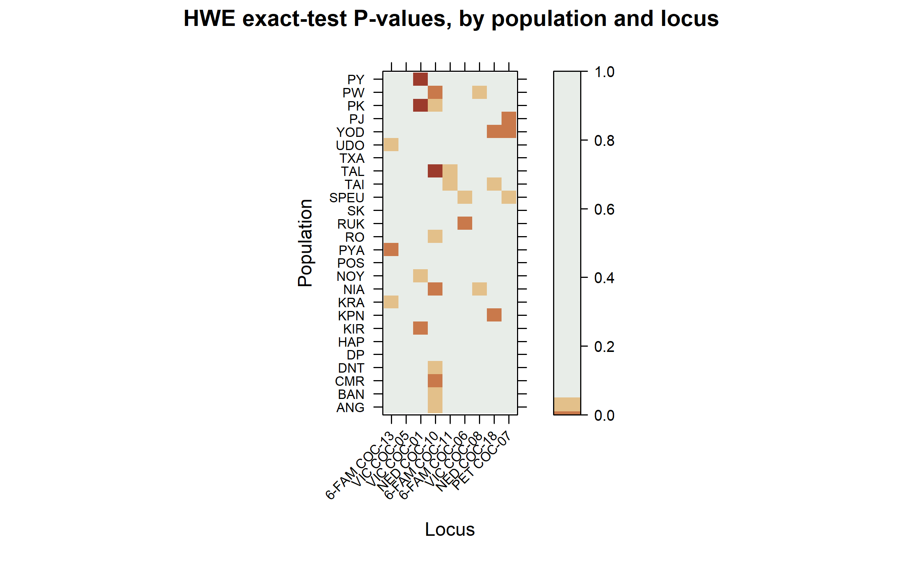
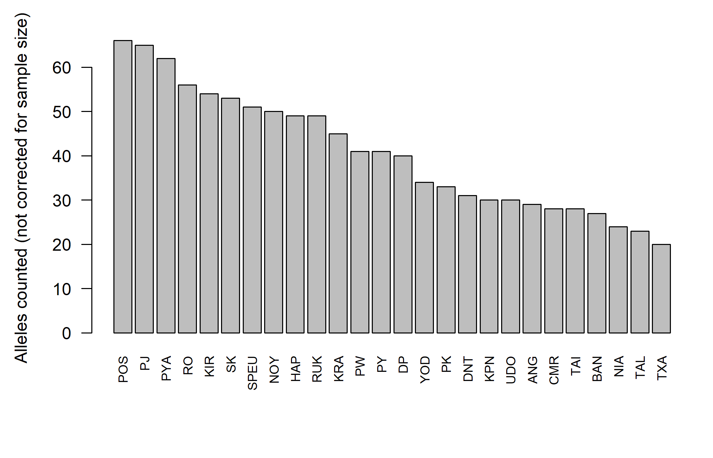
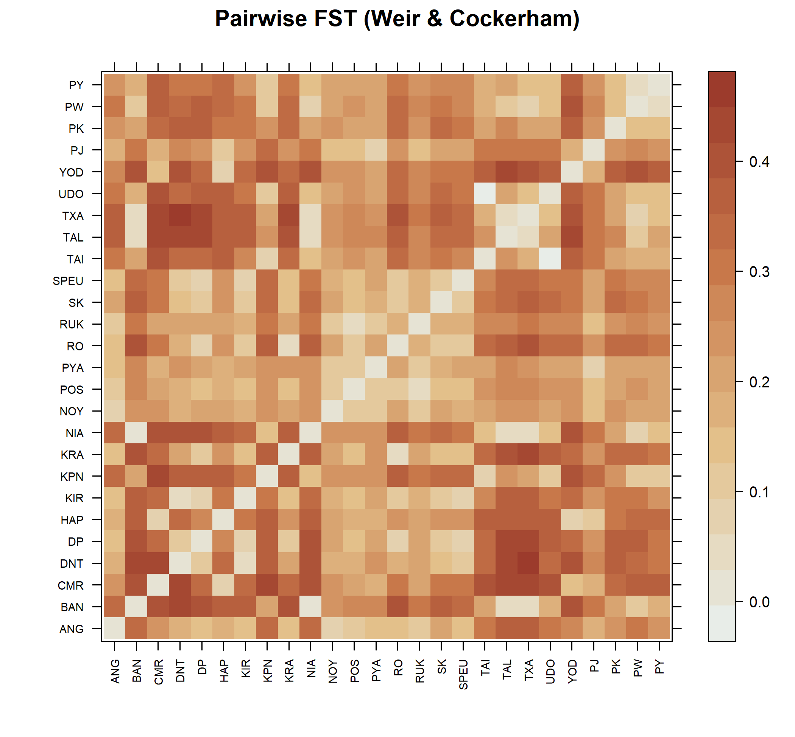
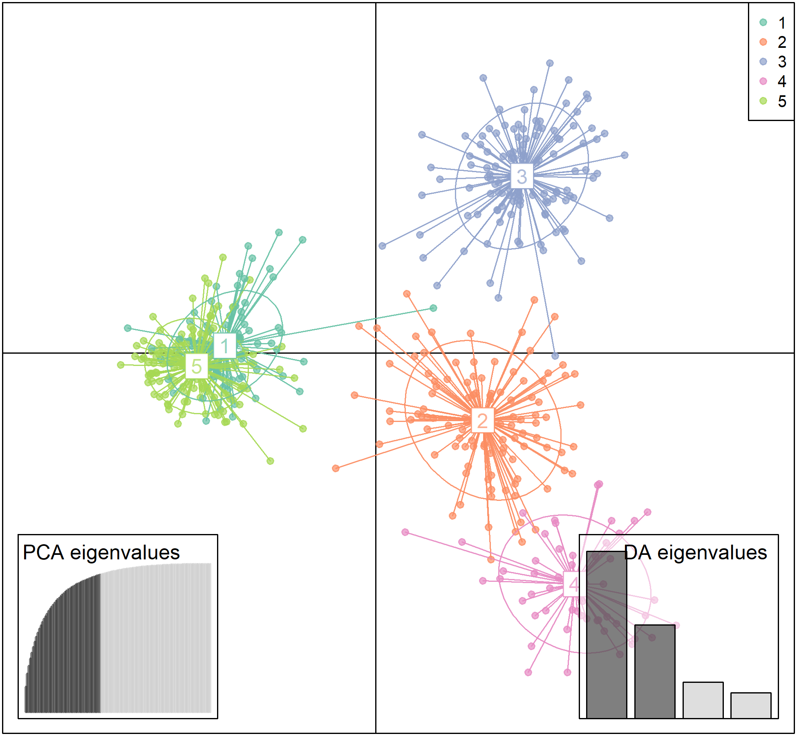
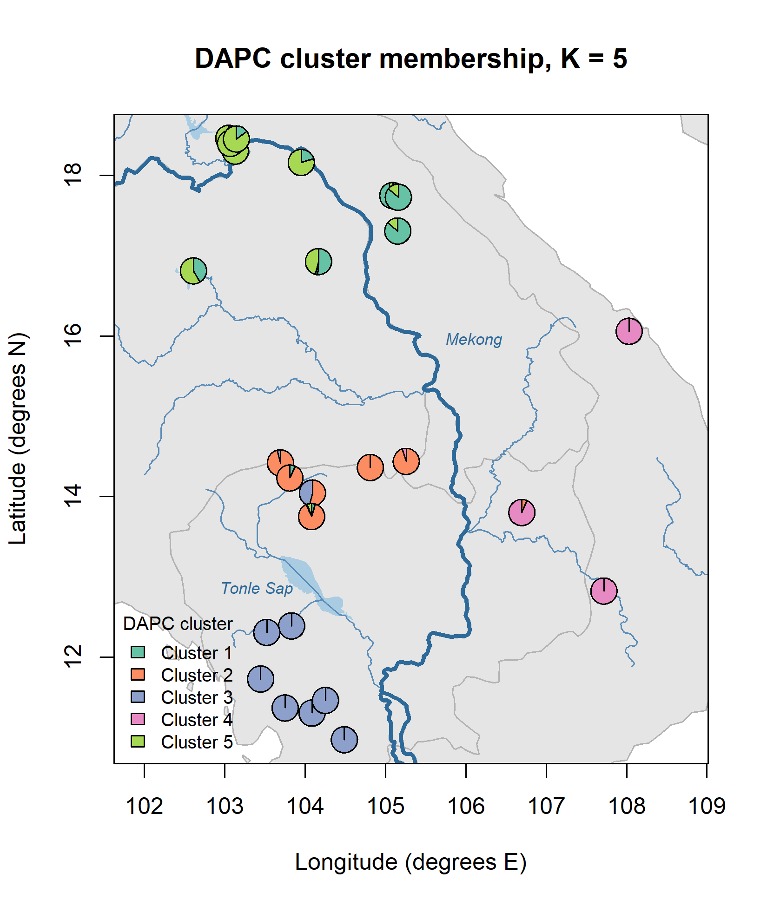
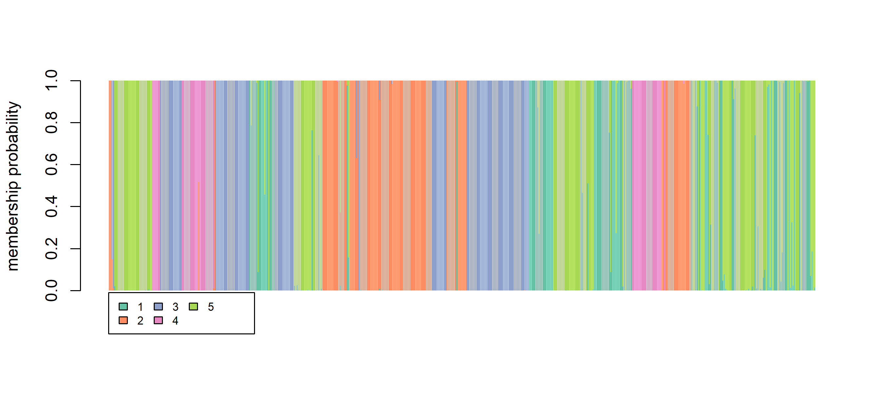

```{r knitr-setup, include = FALSE}
knitr::opts_chunk$set(
  echo = TRUE, message = FALSE, warning = FALSE,
  fig.width = 8, fig.height = 5, dpi = 120
)
```

This file runs the practical from end to end: every code block from the handout, in
the same order, with the same seeds. Quoted lines are the handout's **Expect to see**
boxes.

Put `rosewood.csv`, `rosewood_coords.csv` and `rosewood_water.csv` in the same folder
as this file, then knit. Knitting creates an `outputs/` folder beside it, exactly as
the practical does.

The teaching figures and the checks against these expected numbers live in a separate
file, `rosewood_activity1_aux.Rmd`.

# Station 0 · Set up so someone else could repeat you

## 0.2 Run the setup script

Install the packages once if you do not have them (this chunk is not run when knitting):

```{r install, eval = FALSE}
install.packages(c("poppr", "pegas", "hierfstat", "adegenet", "ade4",
                   "lattice", "mapplots", "maps", "RColorBrewer"))
```

```{r station-0}
# ---- 1. Where am I? Everything below reads and writes relative to here ----
getwd()                 # should end in /rosewood
list.files()            # should list the three .csv files

# ---- 2. Somewhere for figures and tables to land ----
dir.create("outputs", showWarnings = FALSE)

# ---- 3. Packages ----
pkgs <- c("poppr", "pegas", "hierfstat", "adegenet", "ade4",
          "lattice", "mapplots", "maps", "RColorBrewer")
need <- pkgs[!pkgs %in% rownames(installed.packages())]
if (length(need)) install.packages(need)
invisible(lapply(pkgs, library, character.only = TRUE))

# ---- 4. Record exactly what you ran ----
R.version.string
data.frame(package = pkgs,
           version = sapply(pkgs, function(p) as.character(packageVersion(p))))

# ---- 5. One seed for the session ----
set.seed(2026)
```

> No red error messages. A table of nine packages and their versions.

# Station 1 · Know your data before you analyse it

## 1.2 Load the data into R and check its size

```{r task-1-2}
rosewood <- read.genalex("rosewood.csv")
rosewood

nInd(rosewood); nLoc(rosewood); nPop(rosewood)
table(pop(rosewood))      # sample size per population
locNames(rosewood)        # the 9 locus names
```

> 523 individuals, 9 loci, 26 populations, ploidy 2. Sample sizes vary a lot: ANG has
> only 4 trees, while PY has 33.

## 1.3 Are 9 loci enough? Build the genotype accumulation curve

```{r task-1-3}
set.seed(2026)
gac <- genotype_curve(rosewood, sample = 1000, quiet = TRUE)
```

> Boxplots that rise steeply and then level off. With 1 locus, about 60 genotypes.
> With 8 loci, about 520 of the 523 trees. With all 9, every tree has its own genotype.

## 1.4 Look at the loci one at a time

```{r task-1-4}
(rw_lt <- locus_table(rosewood))
```

> One row per locus, plus a mean. Each locus has between 11 and 17 alleles.
> `VIC COC-01` is the most even (0.80) and `NED COC-18` is the least even (0.44).

## 1.5 Find the missing data

```{r task-1-5}
info_table(rosewood, type = "missing", plot = TRUE)
```

> Very little data is missing. The worst locus is `NED COC-10` (4.0%) and the worst
> population is `DNT` (3.7%). Overall, less than 1% is missing.

## 1.6 Get the overall summary, and learn to read a help page

```{r task-1-6-help, eval = FALSE}
?poppr
```

```{r task-1-6}
poppr(rosewood)
```

> One row per population, plus a Total row. `MLG` equals `N` everywhere, so there are
> no clones. `Hexp` (He per population) ranges from 0.36 in `TXA` to 0.77 in `POS`.

# Station 2 · Hardy–Weinberg: compare Ho and He

## 2.1 Test HWE across the whole dataset

```{r task-2-1}
set.seed(2026)
(rw_hwe_all <- hw.test(rosewood, B = 1000))
```

> All nine loci depart from Hardy–Weinberg. Both P-values show as 0.

## 2.2 Now test each population separately

```{r task-2-2}
set.seed(2026)
rw_hwe_pop <- lapply(seppop(rosewood), hw.test, B = 1000)

# Keep only column 3 of each result: the permutation-based (exact) P-value
rw_hwe_mat <- sapply(rw_hwe_pop, "[", i = TRUE, j = 3)
dim(rw_hwe_mat)           # 9 loci x 26 populations
round(rw_hwe_mat[, 1:5], 3)
```

## 2.3 Plot the P-values as a heatmap

```{r task-2-3, results = "hide"}
png("outputs/fig_hwe_heatmap.png", width = 8, height = 5, units = "in", res = 300)
print(levelplot(rw_hwe_mat,
      xlab = "Locus", ylab = "Population",
      main = "HWE exact-test P-values, by population and locus",
      scales = list(x = list(rot = 45, cex = 0.7), y = list(cex = 0.7)),
      at = c(0, 0.001, 0.01, 0.05, 1),
      col.regions = c("#9C3B2C", "#C9794B", "#E3C08A", "#E8EDE8")))
dev.off()
```

```{r task-2-3-show, echo = FALSE, out.width = "85%"}

```

> Mostly pale cells, with a few dark ones. One locus has more dark cells than the others.

## 2.4 Count the significant tests, and compare with chance

```{r task-2-4}
sum(!is.na(rw_hwe_mat))                               # how many tests did you run?
sum(rw_hwe_mat < 0.05, na.rm = TRUE)                  # how many came out "significant"?
0.05 * sum(!is.na(rw_hwe_mat))                        # how many with no real effect at all

hwe_fdr <- p.adjust(rw_hwe_mat, method = "BH")
sum(hwe_fdr < 0.05, na.rm = TRUE)                     # survivors after correction
```

> 234 tests, 28 significant, about 12 expected by chance, only 3 left after BH.

```{r task-2-4b}
sort(rowSums(rw_hwe_mat < 0.05, na.rm = TRUE), decreasing = TRUE)   # by locus
sort(colSums(rw_hwe_mat < 0.05, na.rm = TRUE), decreasing = TRUE)   # by population
```

> No population has more than 2 significant loci, but `NED COC-10` is significant in
> 9 of the 26 populations.

# Station 3 · Are your 9 loci 9 independent markers?

## 3.1 Test for association among loci across the whole dataset

```{r task-3-1}
set.seed(2026)
ia(rosewood, sample = 199)
```

> IA = 1.093 and rbarD = 0.137, both with p = 0.005.

## 3.2 Run the same test inside a single population

```{r task-3-2}
set.seed(2026)
ia(popsub(rosewood, "PY"), sample = 199)      # PY is the largest population, n = 33
```

> IA = 0.221 and rbarD = 0.030, p = 0.05.

## 3.3 Find the strongest pair, and read the effect size

```{r task-3-3}
rw_pair <- pair.ia(rosewood)
nrow(rw_pair)                       # how many pairs is that?
head(round(rw_pair[order(-rw_pair[, "rbarD"]), ], 3))
```

> 36 pairs. The strongest is `6-FAM COC-06` with `PET COC-07` (0.257), then
> `6-FAM COC-11` with `6-FAM COC-06` (0.255). All other pairs are below 0.22.

# Station 4 · Count carefully, then correct for effort

## 4.1 Count alleles per population

```{r task-4-1}
rw_sum <- summary(rosewood)
names(rw_sum)              # see what else is in there
rw_sum$pop.n.all           # alleles counted, per population
rw_sum$n.by.pop            # trees sampled, per population

png("outputs/fig_alleles_raw.png", width = 7, height = 4.5, units = "in", res = 300)
par(mar = c(6, 4.5, 2, 1))
barplot(sort(rw_sum$pop.n.all, decreasing = TRUE), las = 2, cex.names = 0.75,
        ylab = "Alleles counted (not corrected for sample size)")
dev.off()
```

```{r task-4-1-show, echo = FALSE, out.width = "75%"}

```

> `POS` has the most alleles (66) and `TXA` the fewest (20).

## 4.2 Check whether sample size explains the differences

```{r task-4-2}
d <- data.frame(pop     = names(rw_sum$pop.n.all),
                n       = as.numeric(rw_sum$n.by.pop),
                alleles = as.numeric(rw_sum$pop.n.all))

plot(d$n, d$alleles, pch = 19, col = "#1D6B56",
     xlab = "Trees sampled", ylab = "Alleles counted")
fit <- lm(alleles ~ n, data = d)
abline(fit, col = "#9C3B2C", lwd = 2)
summary(fit)
```

> Slope = 0.53 alleles per extra tree, p = 0.115, adjusted R² = 0.063. The correlation
> is 0.317, so the relationship is not significant.

```{r task-4-2b}
cor(d$n, d$alleles)
```

## 4.3 Convert to the hierfstat format

```{r task-4-3}
rw_hfstat <- genind2hierfstat(rosewood)
dim(rw_hfstat)             # 523 rows; column 1 is population, then one per locus
rw_hfstat[1:4, 1:4]
```

## 4.4 Compute rarefied allelic richness

```{r task-4-4}
rw_ar <- allelic.richness(rw_hfstat)
rw_ar$min.all                           # the common number of gene copies used
rw_pop_ar <- colMeans(rw_ar$Ar, na.rm = TRUE)

d$richness <- rw_pop_ar[d$pop]
cor(d$n, d$alleles)        # raw counts vs sample size
cor(d$n, d$richness)       # rarefied richness vs sample size

plot(d$alleles, d$richness, pch = 19, col = "#1D6B56",
     xlab = "Alleles counted (raw)", ylab = "Rarefied allelic richness")
text(d$alleles, d$richness, labels = d$pop, pos = 4, cex = 0.55)
```

> `rw_ar$min.all` = 8 gene copies. The correlation with sample size drops from 0.317
> to −0.043. ANG rises to 13th (3.22), ahead of PY (2.64, 16th).

## 4.5 Get heterozygosity and FIS per population

```{r task-4-5}
rw_pop_stat <- basic.stats(rw_hfstat, diploid = TRUE, digits = 3)
names(rw_pop_stat)

rw_pop_stat$Ho[1:3, 1:4]        # a locus x population matrix, not one number per population

rw_pop_ho  <- colMeans(rw_pop_stat$Ho,  na.rm = TRUE)
rw_pop_hs  <- colMeans(rw_pop_stat$Hs,  na.rm = TRUE)
rw_pop_fis <- colMeans(rw_pop_stat$Fis, na.rm = TRUE)

mean(rw_pop_hs)                 # compare with the published value for this species
rw_pop_stat$overall
```

**Ho** is observed heterozygosity, **He** is expected heterozygosity. He depends on
which trees you count as one population, so R gives it at two levels: `Hs` is He within
each population, `Ht` is He for all 523 trees pooled. FIS = 1 − Ho / He(within), and
FST = (He(pooled) − He(within)) / He(pooled).

> Mean Ho = 0.562, mean He within populations = 0.569, mean FIS = 0.020. `Ht` is 0.754,
> much higher than He within populations, giving FST = 0.247.

## 4.6 Bootstrap a confidence interval for FIS

```{r task-4-6}
set.seed(2026)
fis_ci <- boot.ppfis(rw_hfstat, nboot = 1000)$fis.ci
head(fis_ci)                       # columns: lower limit, upper limit
nrow(fis_ci)                       # 26 rows, one per population

pop_order <- levels(factor(rw_hfstat$pop))   # the order those rows follow
head(pop_order)
```

## 4.7 Combine the results into one table

```{r task-4-7}
rw_table <- data.frame(
  pop      = pop_order,
  n        = as.numeric(rw_sum$n.by.pop[pop_order]),
  alleles  = as.numeric(rw_sum$pop.n.all[pop_order]),
  richness = round(rw_pop_ar[pop_order],  2),
  Ho       = round(rw_pop_ho[pop_order],  3),
  He       = round(rw_pop_hs[pop_order],  3),   # hierfstat calls this Hs
  Fis      = round(rw_pop_fis[pop_order], 3),
  Fis_lo   = round(fis_ci[, 1], 3),
  Fis_hi   = round(fis_ci[, 2], 3),
  row.names = NULL
)

rw_table$deficit_supported <- rw_table$Fis_lo > 0
rw_table$excess_supported  <- rw_table$Fis_hi < 0

write.csv(rw_table, "outputs/table_diversity.csv", row.names = FALSE)
rw_table[order(-rw_table$richness), ]
```

> 26 rows and no missing values. Ho is lower than He in 13 populations and higher in
> the other 13. Both TRUE/FALSE columns add up to 0. Top by rarefied richness:
> POS (4.15), PYA (4.01), RO (3.97). Bottom: TXA (1.96), TAL (2.14), NIA (2.20).

## 4.8 Interpret the difference between Ho and He

```{r task-4-8}
rw_table[rw_table$pop == "NIA", ]
```

> NIA: Ho = 0.394, He = 0.442, FIS = 0.128 (95% CI −0.060 to 0.357).

# Station 5 · Structure

## 5.1 Measure how different each pair of populations is

```{r task-5-1}
fst_dist <- genet.dist(rw_hfstat, method = "WC84")   # Weir & Cockerham 1984
fst <- as.matrix(fst_dist)
dim(fst)                              # 26 x 26
round(fst[1:5, 1:5], 3)

pairs <- fst[lower.tri(fst)]          # the 325 unique pairs
range(pairs); mean(pairs)             # compare the mean with the published GST = 0.25
```

```{r task-5-1-png, results = "hide"}
png("outputs/fig_fst_heatmap.png", width = 7, height = 6.5, units = "in", res = 300)
print(levelplot(fst, xlab = "", ylab = "",
      main = "Pairwise FST (Weir & Cockerham)",
      scales = list(x = list(rot = 90, cex = 0.6), y = list(cex = 0.6)),
      col.regions = colorRampPalette(c("#E8EDE8", "#E3C08A", "#C9794B", "#9C3B2C"))(100)))
dev.off()
```

```{r task-5-1-show, echo = FALSE, out.width = "70%"}

```

> 325 pairs. The mean FST is 0.247. Values range from −0.004 to 0.449 (TXA and DNT).

## 5.2 Test whether genetic differences increase with distance

```{r task-5-2}
rw_coords <- read.csv("rosewood_coords.csv", row.names = 1)
head(rw_coords)                       # which column is longitude, which latitude?

common <- intersect(rownames(fst), rownames(rw_coords))
length(common)                        # must be 26
fst_m <- fst[common, common]
geo_m <- as.matrix(dist(rw_coords[common, 1:2]))

plot(geo_m[lower.tri(geo_m)], fst_m[lower.tri(fst_m)],
     pch = 19, col = "#1D6B5655",
     xlab = "Geographic distance between the pair (degrees)",
     ylab = "Pairwise FST")
abline(lm(fst_m[lower.tri(fst_m)] ~ geo_m[lower.tri(geo_m)]), col = "#9C3B2C", lwd = 2)

set.seed(2026)
mantel.randtest(as.dist(fst_m), as.dist(geo_m), nrepet = 999)
```

> Observation = 0.880 and p = 0.001.

## 5.3 Choose the number of clusters (K)

This is the line you run in the practical. R draws the BIC graph, asks
`Choose the number of clusters (>=2):`, and you type `5`:

```{r task-5-3-student, eval = FALSE}
set.seed(2026)
grp <- find.clusters(rosewood, max.n.clust = 20, n.pca = 150)

# R now draws the BIC graph and asks:
#   Choose the number of clusters (>=2):
# Type 5 and press Enter.

table(grp$grp)                  # how many trees in each cluster?
```

When knitting there is nobody at the keyboard, so the chunk below answers `5` for you.
It gives exactly the same clusters as typing it.

```{r task-5-3}
options(adegenet.testcon = textConnection("5"))   # stands in for typing 5
set.seed(2026)
grp <- find.clusters(rosewood, max.n.clust = 20, n.pca = 150)
options(adegenet.testcon = stdin())               # back to normal

table(grp$grp)
```

> Five clusters with 101, 111, 119, 54 and 138 trees.

## 5.4 Check how clusters relate to the sampled populations

```{r task-5-4}
tab <- table(pop(rosewood), grp$grp)
tab                             # populations x clusters
rowSums(tab > 0)                # how many clusters does each population contain?
```

> 13 populations fall completely into one cluster; the other 13 contain trees from more
> than one. PK splits 12 and 17, PY splits 17 and 15.

## 5.5 Run the DAPC

```{r task-5-5}
rw_dapc <- dapc(rosewood, grp$grp, n.pca = 50, n.da = 4)
rw_dapc
```

## 5.6 Plot the clusters, with a legend

```{r task-5-6, results = "hide"}
K <- 5
clust_cols <- brewer.pal(K, "Set2")

png("outputs/fig_dapc_scatter.png", width = 6.5, height = 6, units = "in", res = 300)
scatter(rw_dapc, col = clust_cols, cex = 1.1,
        scree.da = TRUE, scree.pca = TRUE, posi.pca = "bottomleft",
        legend = TRUE, posi.leg = "topright", cleg = 0.8)
dev.off()
```

```{r task-5-6-show, echo = FALSE, out.width = "65%"}

```

## 5.7 Work out cluster membership for each population and map it

```{r task-5-7}
postprobs <- as.data.frame(rw_dapc$posterior)
round(head(postprobs), 3)

rw_pops <- pop(rosewood)
qpop <- t(sapply(levels(rw_pops),
                 function(p) colMeans(postprobs[rw_pops == p, , drop = FALSE])))
round(qpop, 3)
range(rowSums(qpop))            # must be 1, 1
```

```{r task-5-7b}
# rw_coords is already loaded from task 5.2 - harmless to re-run
rw_coords <- read.csv("rosewood_coords.csv", row.names = 1)

setdiff(rownames(qpop),      rownames(rw_coords))   # must be empty
setdiff(rownames(rw_coords), rownames(qpop))        # must be empty
identical(rownames(qpop), rownames(rw_coords))      # TRUE only if already aligned

qpop <- qpop[rownames(rw_coords), ]             # align by name, not by position
```

> Both `setdiff()` results are empty and `identical()` is TRUE. PYA, TAL, CMR and YOD
> are all 1.000. PK splits 0.416 / 0.584, PY 0.508 / 0.462, ANG 0.540 / 0.460.

```{r task-5-7-map, results = "hide"}
clust_cols <- brewer.pal(K, "Set2")

png("outputs/fig_map_dapc.png", width = 5.5, height = 6.5, units = "in", res = 300)

plot(rw_coords[, 1], rw_coords[, 2], type = "n", asp = 1,
     xlab = "Longitude (degrees E)", ylab = "Latitude (degrees N)",
     main = "DAPC cluster membership, K = 5")
maps::map(add = TRUE, col = "grey90", fill = TRUE, border = "grey70")

# Rivers and lakes (Natural Earth 1:10m, clipped to this region)
water  <- read.csv("rosewood_water.csv")
lakes  <- water[water$type == "lake", ]
rivers <- water[water$type == "river", ]
polygon(lakes$lon, lakes$lat, col = "#A9CCE3", border = NA)
lines(rivers$lon, rivers$lat, col = "#5B8DB8", lwd = 1.2)
mekong <- rivers[rivers$name == "Mekong", ]
lines(mekong$lon, mekong$lat, col = "#2E6A99", lwd = 3)       # the Mekong, drawn thicker
text(c(106.1, 103.4), c(15.95, 12.85), c("Mekong", "Tonle Sap"),
     col = "#2E6A99", cex = 0.7, font = 3)
box()

# Radius from the size of the plotted area, not from a magic number
r <- 0.03 * diff(range(rw_coords[, 1]))

for (i in seq_len(nrow(qpop))) {
  add.pie(z = qpop[i, ], x = rw_coords[i, 1], y = rw_coords[i, 2],
          labels = "", col = clust_cols, radius = r)
}

legend("bottomleft", legend = paste("Cluster", 1:K), fill = clust_cols,
       bty = "n", cex = 0.8, title = "DAPC cluster")
dev.off()
```

```{r task-5-7-show, echo = FALSE, out.width = "55%"}

```

> Neighbouring populations mostly share the same colours, and a colour boundary follows
> the Mekong.

## 5.8 + optional · Check whether the clusters change with K

```{r task-5-8}
set.seed(2026)
grp3 <- find.clusters(rosewood, max.n.clust = 20, n.pca = 150,
                      n.clust = 3, choose.n.clust = FALSE)
set.seed(2026)
grp7 <- find.clusters(rosewood, max.n.clust = 20, n.pca = 150,
                      n.clust = 7, choose.n.clust = FALSE)

table(grp$grp, grp3$grp)        # which K=5 clusters merge at K=3?
table(grp$grp, grp7$grp)        # which K=5 clusters split at K=7?
```

> Clusters 3 and 4 stay almost the same. At K = 3, clusters 1 and 5 merge; at K = 7,
> clusters 1, 2 and 5 each split in two.

## 5.9 + optional · Look at individual admixture

```{r task-5-9, results = "hide"}
png("outputs/fig_compoplot.png", width = 9, height = 4, units = "in", res = 300)
compoplot(rw_dapc, col.pal = function(n) brewer.pal(n, "Set2"),
          ncol = 5, cleg = 0.7)
dev.off()
```

```{r task-5-9-show, echo = FALSE, out.width = "90%"}

```

# Station 6 · From science to conservation recommendations

Station 6 has no code. It uses `outputs/table_diversity.csv` from 4.7 and
`outputs/fig_map_dapc.png` from 5.7, both written above.

# Reference · the catch-up block

This is the block in the handout's Reference section, for anyone who falls behind. It
repeats Stations 1 to 4 without plots, so it is not run here.

```{r catchup, eval = FALSE}
# ---- Catch-up: Stations 1 to 4, essentials only ----
set.seed(2026)

rosewood  <- read.genalex("rosewood.csv")
stopifnot(nInd(rosewood) == 523, nLoc(rosewood) == 9, nPop(rosewood) == 26)

# Station 2: HWE per population
rw_hwe_pop <- lapply(seppop(rosewood), hw.test, B = 1000)
rw_hwe_mat <- sapply(rw_hwe_pop, "[", i = TRUE, j = 3)
cat("significant raw:", sum(rw_hwe_mat < 0.05, na.rm = TRUE),
    "| expected by chance:", round(0.05 * sum(!is.na(rw_hwe_mat))),
    "| after BH:", sum(p.adjust(rw_hwe_mat, "BH") < 0.05, na.rm = TRUE), "\n")

# Station 4: diversity, rarefied richness, FIS with CI
rw_sum      <- summary(rosewood)
rw_hfstat   <- genind2hierfstat(rosewood)
rw_ar       <- allelic.richness(rw_hfstat)
rw_pop_ar   <- colMeans(rw_ar$Ar, na.rm = TRUE)
rw_pop_stat <- basic.stats(rw_hfstat, diploid = TRUE, digits = 3)

set.seed(2026)
fis_ci    <- boot.ppfis(rw_hfstat, nboot = 1000)$fis.ci
pop_order <- levels(factor(rw_hfstat$pop))

rw_table <- data.frame(
  pop      = pop_order,
  n        = as.numeric(rw_sum$n.by.pop[pop_order]),
  alleles  = as.numeric(rw_sum$pop.n.all[pop_order]),
  richness = round(rw_pop_ar[pop_order], 2),
  Ho       = round(colMeans(rw_pop_stat$Ho,  na.rm = TRUE)[pop_order], 3),
  He       = round(colMeans(rw_pop_stat$Hs,  na.rm = TRUE)[pop_order], 3),
  Fis      = round(colMeans(rw_pop_stat$Fis, na.rm = TRUE)[pop_order], 3),
  Fis_lo   = round(fis_ci[, 1], 3),
  Fis_hi   = round(fis_ci[, 2], 3),
  row.names = NULL
)
rw_table$deficit_supported <- rw_table$Fis_lo > 0

dir.create("outputs", showWarnings = FALSE)
write.csv(rw_table, "outputs/table_diversity.csv", row.names = FALSE)

cat("mean He:", round(mean(rw_table$He), 3), "(published: 0.55)\n")
cat("populations with FIS interval above 0:", sum(rw_table$deficit_supported), "of 26\n")
head(rw_table[order(-rw_table$richness), ], 8)
```

```{r session-info}
sessionInfo()
```
