Activity 1: rosewood population genetics
================
Tin Hang Hung
2026-10-27

- [Station 0 · Set up so someone else could repeat
  you](#station-0--set-up-so-someone-else-could-repeat-you)
  - [0.2 Run the setup script](#02-run-the-setup-script)
- [Station 1 · Know your data before you analyse
  it](#station-1--know-your-data-before-you-analyse-it)
  - [1.2 Load the data into R and check its
    size](#12-load-the-data-into-r-and-check-its-size)
  - [1.3 Are 9 loci enough? Build the genotype accumulation
    curve](#13-are-9-loci-enough-build-the-genotype-accumulation-curve)
  - [1.4 Look at the loci one at a
    time](#14-look-at-the-loci-one-at-a-time)
  - [1.5 Find the missing data](#15-find-the-missing-data)
  - [1.6 Get the overall summary, and learn to read a help
    page](#16-get-the-overall-summary-and-learn-to-read-a-help-page)
- [Station 2 · Hardy–Weinberg: compare Ho and
  He](#station-2--hardyweinberg-compare-ho-and-he)
  - [2.1 Test HWE across the whole
    dataset](#21-test-hwe-across-the-whole-dataset)
  - [2.2 Now test each population
    separately](#22-now-test-each-population-separately)
  - [2.3 Plot the P-values as a
    heatmap](#23-plot-the-p-values-as-a-heatmap)
- [Station 3 · Are your 9 loci 9 independent
  markers?](#station-3--are-your-9-loci-9-independent-markers)
  - [3.1 Test for association among loci across the whole
    dataset](#31-test-for-association-among-loci-across-the-whole-dataset)
  - [3.2 Run the same test inside a single
    population](#32-run-the-same-test-inside-a-single-population)
  - [3.3 Find the strongest pair, and read the effect
    size](#33-find-the-strongest-pair-and-read-the-effect-size)
- [Station 4 · Count carefully, then correct for
  effort](#station-4--count-carefully-then-correct-for-effort)
  - [4.1 Count alleles per population](#41-count-alleles-per-population)
  - [4.2 Check whether sample size explains the
    differences](#42-check-whether-sample-size-explains-the-differences)
  - [4.3 Convert to the hierfstat
    format](#43-convert-to-the-hierfstat-format)
  - [4.4 Compute rarefied allelic
    richness](#44-compute-rarefied-allelic-richness)
  - [4.5 Get heterozygosity and FIS per
    population](#45-get-heterozygosity-and-fis-per-population)
  - [4.6 Bootstrap a confidence interval for
    FIS](#46-bootstrap-a-confidence-interval-for-fis)
  - [4.7 Combine the results into one
    table](#47-combine-the-results-into-one-table)
  - [4.8 Interpret the difference between Ho and
    He](#48-interpret-the-difference-between-ho-and-he)
- [Station 5 · Structure](#station-5--structure)
  - [5.1 Measure how different each pair of populations
    is](#51-measure-how-different-each-pair-of-populations-is)
  - [5.2 Test whether genetic differences increase with
    distance](#52-test-whether-genetic-differences-increase-with-distance)
  - [5.3 Choose the number of clusters
    (K)](#53-choose-the-number-of-clusters-k)
  - [5.4 Check how clusters relate to the sampled
    populations](#54-check-how-clusters-relate-to-the-sampled-populations)
  - [5.5 Run the DAPC](#55-run-the-dapc)
  - [5.6 Plot the clusters, with a
    legend](#56-plot-the-clusters-with-a-legend)
  - [5.7 Work out cluster membership for each population and map
    it](#57-work-out-cluster-membership-for-each-population-and-map-it)
  - [5.8 + optional · Check whether the clusters change with
    K](#58--optional--check-whether-the-clusters-change-with-k)
- [Station 6 · From science to conservation
  recommendations](#station-6--from-science-to-conservation-recommendations)

This file runs the practical from end to end: every code block from the
handout, in the same order, with the same seeds. Quoted lines are the
handout’s **Expect to see** boxes.

Put `rosewood.csv`, `rosewood_coords.csv` and `rosewood_water.csv` in
the same folder as this file, then knit. Everything plots to the
document; nothing is written to disk.

The teaching figures and the checks against these expected numbers live
in a separate file, `rosewood_activity1_aux.Rmd`.

# Station 0 · Set up so someone else could repeat you

## 0.2 Run the setup script

The handout installs the packages here. That only needs doing once, so
it is shown but not run when knitting:

``` r
install.packages(c("poppr", "pegas", "hierfstat", "adegenet", "ade4",
          "lattice", "mapplots", "maps", "RColorBrewer"))
```

``` r
# ---- 1. Where am I? Everything below reads and writes relative to here ----
getwd()                 # should end in /rosewood
```

    ## [1] "C:/Users/univ4423/AppData/Local/Temp/rwmd"

``` r
list.files()            # should list the three .csv files
```

    ## [1] "figures"                    "rosewood.csv"              
    ## [3] "rosewood_activity1.Rmd"     "rosewood_activity1_aux.Rmd"
    ## [5] "rosewood_coords.csv"        "rosewood_water.csv"

``` r
# ---- 2. Packages ----
library(poppr)
library(adegenet)
library(pegas)
library(hierfstat)
library(ade4)
library(lattice)
library(maps)
library(mapplots)
library(RColorBrewer)

# ---- 3. Setting a seed ----
# Several steps today sample at random. set.seed() fixes those random numbers so
# your results match this page. You will see this same line again before each
# random step, so that any one task can be re-run on its own and still agree.
set.seed(2026)
```

> No red error messages, and `list.files()` shows all three CSV files.

# Station 1 · Know your data before you analyse it

## 1.2 Load the data into R and check its size

``` r
rosewood <- read.genalex("rosewood.csv")
rosewood
```

    ## 
    ## This is a genclone object
    ## -------------------------
    ## Genotype information:
    ## 
    ##    523 original multilocus genotypes 
    ##    523 diploid individuals
    ##      9 codominant loci
    ## 
    ## Population information:
    ## 
    ##      1 stratum - Pop
    ##     26 populations defined - ANG, BAN, CMR, ..., PK, PW, PY

``` r
nInd(rosewood); nLoc(rosewood); nPop(rosewood)
```

    ## [1] 523

    ## [1] 9

    ## [1] 26

``` r
table(pop(rosewood))      # sample size per population
```

    ## 
    ##  ANG  BAN  CMR  DNT   DP  HAP  KIR  KPN  KRA  NIA  NOY  POS  PYA   RO  RUK   SK 
    ##    4   28    6    6   10   25   25   19   14   21   26   28   27   11   15   24 
    ## SPEU  TAI  TAL  TXA  UDO  YOD   PJ   PK   PW   PY 
    ##   22   18   17   13   28   22   22   29   30   33

``` r
locNames(rosewood)        # the 9 locus names
```

    ## [1] "6-FAM COC-13" "VIC COC-05"   "VIC COC-01"   "NED COC-10"   "6-FAM COC-11"
    ## [6] "6-FAM COC-06" "VIC COC-08"   "NED COC-18"   "PET COC-07"

> 523 individuals, 9 loci, 26 populations, ploidy 2. Sample sizes vary a
> lot: ANG has only 4 trees, while PY has 33.

## 1.3 Are 9 loci enough? Build the genotype accumulation curve

``` r
set.seed(2026)                  # sample = 1000 draws loci at random, so seed it
gac <- genotype_curve(rosewood, sample = 1000, quiet = TRUE)
```

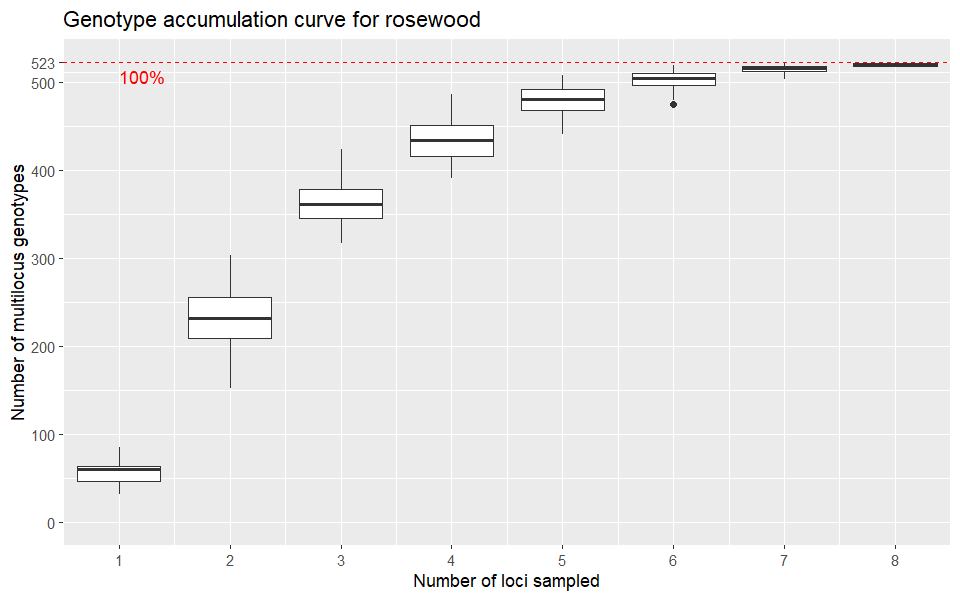<!-- -->

> Boxplots that rise steeply and then level off. The x-axis stops at 8
> loci, because the function always leaves one out. With 1 locus, about
> 60 genotypes. With 8 loci, about 520 of the 523 trees.

## 1.4 Look at the loci one at a time

``` r
(rw_lt <- locus_table(rosewood))
```

    ##               summary
    ## locus          allele   1-D  Hexp Evenness
    ##   6-FAM COC-13  17.00  0.74  0.74     0.59
    ##   VIC COC-05    12.00  0.53  0.53     0.47
    ##   VIC COC-01    11.00  0.78  0.79     0.80
    ##   NED COC-10    14.00  0.78  0.79     0.71
    ##   6-FAM COC-11  14.00  0.75  0.75     0.64
    ##   6-FAM COC-06  17.00  0.75  0.75     0.59
    ##   VIC COC-08    17.00  0.84  0.84     0.73
    ##   NED COC-18    15.00  0.65  0.65     0.44
    ##   PET COC-07    16.00  0.85  0.85     0.66
    ##   mean          14.78  0.74  0.74     0.62

> One row per locus, plus a mean. Each locus has between 11 and 17
> alleles. `VIC COC-01` is the most even (0.80) and `NED COC-18` is the
> least even (0.44).

## 1.5 Find the missing data

``` r
info_table(rosewood, type = "missing", plot = TRUE)
```

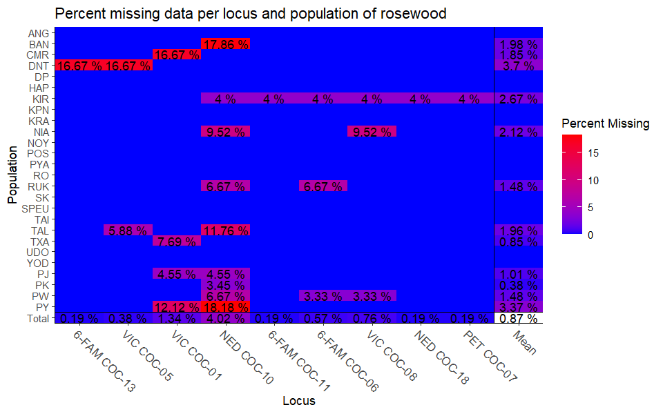<!-- -->

    ##           Locus
    ## Population 6-FAM COC-13 VIC COC-05 VIC COC-01 NED COC-10 6-FAM COC-11
    ##      ANG              .          .          .          .            .
    ##      BAN              .          .          .     0.1786            .
    ##      CMR              .          .     0.1667          .            .
    ##      DNT         0.1667     0.1667          .          .            .
    ##      DP               .          .          .          .            .
    ##      HAP              .          .          .          .            .
    ##      KIR              .          .          .     0.0400       0.0400
    ##      KPN              .          .          .          .            .
    ##      KRA              .          .          .          .            .
    ##      NIA              .          .          .     0.0952            .
    ##      NOY              .          .          .          .            .
    ##      POS              .          .          .          .            .
    ##      PYA              .          .          .          .            .
    ##      RO               .          .          .          .            .
    ##      RUK              .          .          .     0.0667            .
    ##      SK               .          .          .          .            .
    ##      SPEU             .          .          .          .            .
    ##      TAI              .          .          .          .            .
    ##      TAL              .     0.0588          .     0.1176            .
    ##      TXA              .          .     0.0769          .            .
    ##      UDO              .          .          .          .            .
    ##      YOD              .          .          .          .            .
    ##      PJ               .          .     0.0455     0.0455            .
    ##      PK               .          .          .     0.0345            .
    ##      PW               .          .          .     0.0667            .
    ##      PY               .          .     0.1212     0.1818            .
    ##      Total       0.0019     0.0038     0.0134     0.0402       0.0019
    ##           Locus
    ## Population 6-FAM COC-06 VIC COC-08 NED COC-18 PET COC-07   Mean
    ##      ANG              .          .          .          .      .
    ##      BAN              .          .          .          . 0.0198
    ##      CMR              .          .          .          . 0.0185
    ##      DNT              .          .          .          . 0.0370
    ##      DP               .          .          .          .      .
    ##      HAP              .          .          .          .      .
    ##      KIR         0.0400     0.0400     0.0400     0.0400 0.0267
    ##      KPN              .          .          .          .      .
    ##      KRA              .          .          .          .      .
    ##      NIA              .     0.0952          .          . 0.0212
    ##      NOY              .          .          .          .      .
    ##      POS              .          .          .          .      .
    ##      PYA              .          .          .          .      .
    ##      RO               .          .          .          .      .
    ##      RUK         0.0667          .          .          . 0.0148
    ##      SK               .          .          .          .      .
    ##      SPEU             .          .          .          .      .
    ##      TAI              .          .          .          .      .
    ##      TAL              .          .          .          . 0.0196
    ##      TXA              .          .          .          . 0.0085
    ##      UDO              .          .          .          .      .
    ##      YOD              .          .          .          .      .
    ##      PJ               .          .          .          . 0.0101
    ##      PK               .          .          .          . 0.0038
    ##      PW          0.0333     0.0333          .          . 0.0148
    ##      PY               .          .          .          . 0.0337
    ##      Total       0.0057     0.0076     0.0019     0.0019 0.0087

> Very little data is missing. The worst locus is `NED COC-10` (4.0%)
> and the worst population is `DNT` (3.7%). Overall, less than 1% is
> missing.

## 1.6 Get the overall summary, and learn to read a help page

``` r
?poppr
```

``` r
poppr(rosewood)
```

<div class="kable-table">

| Pop | N | MLG | eMLG | SE | H | G | lambda | E.5 | Hexp | Ia | rbarD | File |
|:---|---:|---:|---:|---:|---:|---:|---:|---:|---:|---:|---:|:---|
| ANG | 4 | 4 | 4 | 0.00e+00 | 1.386294 | 4 | 0.7500000 | 1 | 0.7063492 | -0.3870968 | -0.0518457 | rosewood |
| BAN | 28 | 28 | 10 | 3.00e-07 | 3.332205 | 28 | 0.9642857 | 1 | 0.4343229 | 0.0883631 | 0.0116455 | rosewood |
| CMR | 6 | 6 | 6 | 0.00e+00 | 1.791759 | 6 | 0.8333333 | 1 | 0.5104377 | 1.0132979 | 0.1355947 | rosewood |
| DNT | 6 | 6 | 6 | 0.00e+00 | 1.791759 | 6 | 0.8333333 | 1 | 0.5026936 | 1.5321888 | 0.2667010 | rosewood |
| DP | 10 | 10 | 10 | 0.00e+00 | 2.302585 | 10 | 0.9000000 | 1 | 0.6432749 | 1.0557397 | 0.1339318 | rosewood |
| HAP | 25 | 25 | 10 | 0.00e+00 | 3.218876 | 25 | 0.9600000 | 1 | 0.6360091 | 0.5739198 | 0.0721079 | rosewood |
| KIR | 25 | 25 | 10 | 0.00e+00 | 3.218876 | 25 | 0.9600000 | 1 | 0.6512025 | 0.7258155 | 0.0916833 | rosewood |
| KPN | 19 | 19 | 10 | 3.00e-07 | 2.944439 | 19 | 0.9473684 | 1 | 0.4050893 | 0.1728087 | 0.0222779 | rosewood |
| KRA | 14 | 14 | 10 | 0.00e+00 | 2.639057 | 14 | 0.9285714 | 1 | 0.6463845 | 0.4358196 | 0.0549357 | rosewood |
| NIA | 21 | 21 | 10 | 0.00e+00 | 3.044522 | 21 | 0.9523810 | 1 | 0.4406319 | 0.0436094 | 0.0057209 | rosewood |
| NOY | 26 | 26 | 10 | 1.10e-06 | 3.258097 | 26 | 0.9615385 | 1 | 0.6728674 | 0.6440126 | 0.0808176 | rosewood |
| POS | 28 | 28 | 10 | 3.00e-07 | 3.332205 | 28 | 0.9642857 | 1 | 0.7673882 | 0.1045840 | 0.0130835 | rosewood |
| PYA | 27 | 27 | 10 | 0.00e+00 | 3.295837 | 27 | 0.9629630 | 1 | 0.7283951 | 0.2869286 | 0.0359253 | rosewood |
| RO | 11 | 11 | 10 | 0.00e+00 | 2.397895 | 11 | 0.9090909 | 1 | 0.6911977 | 0.6563773 | 0.0831727 | rosewood |
| RUK | 15 | 15 | 10 | 3.00e-07 | 2.708050 | 15 | 0.9333333 | 1 | 0.7210323 | 0.1937840 | 0.0247791 | rosewood |
| SK | 24 | 24 | 10 | 4.00e-07 | 3.178054 | 24 | 0.9583333 | 1 | 0.6512017 | 0.0754773 | 0.0095267 | rosewood |
| SPEU | 22 | 22 | 10 | 0.00e+00 | 3.091042 | 22 | 0.9545455 | 1 | 0.6639652 | 0.0972430 | 0.0122922 | rosewood |
| TAI | 18 | 18 | 10 | 5.00e-07 | 2.890372 | 18 | 0.9444444 | 1 | 0.4453263 | 0.1837876 | 0.0232538 | rosewood |
| TAL | 17 | 17 | 10 | 2.00e-07 | 2.833213 | 17 | 0.9411765 | 1 | 0.4149045 | -0.0125657 | -0.0016520 | rosewood |
| TXA | 13 | 13 | 10 | 1.00e-07 | 2.564949 | 13 | 0.9230769 | 1 | 0.3573529 | 0.0942264 | 0.0125665 | rosewood |
| UDO | 28 | 28 | 10 | 3.00e-07 | 3.332205 | 28 | 0.9642857 | 1 | 0.4419913 | 0.2822685 | 0.0362710 | rosewood |
| YOD | 22 | 22 | 10 | 0.00e+00 | 3.091042 | 22 | 0.9545455 | 1 | 0.5092788 | 0.4772118 | 0.0626677 | rosewood |
| PJ | 22 | 22 | 10 | 0.00e+00 | 3.091042 | 22 | 0.9545455 | 1 | 0.6834778 | 0.2681330 | 0.0340382 | rosewood |
| PK | 29 | 29 | 10 | 1.00e-06 | 3.367296 | 29 | 0.9655172 | 1 | 0.4836118 | 0.0388942 | 0.0049585 | rosewood |
| PW | 30 | 30 | 10 | 0.00e+00 | 3.401197 | 30 | 0.9666667 | 1 | 0.4839959 | -0.0525262 | -0.0068779 | rosewood |
| PY | 33 | 33 | 10 | 8.00e-07 | 3.496508 | 33 | 0.9696970 | 1 | 0.4837899 | 0.2208054 | 0.0299813 | rosewood |
| Total | 523 | 523 | 10 | 2.62e-05 | 6.259582 | 523 | 0.9980880 | 1 | 0.7422959 | 1.0929369 | 0.1374233 | rosewood |

</div>

> One row per population, plus a Total row. `MLG` equals `N` everywhere,
> so there are no clones. `Hexp` (He per population) ranges from 0.36 in
> `TXA` to 0.77 in `POS`.

# Station 2 · Hardy–Weinberg: compare Ho and He

## 2.1 Test HWE across the whole dataset

``` r
set.seed(2026)                  # B = 1000 shuffles, so seed it
(rw_hwe_all <- hw.test(rosewood, B = 1000))
```

    ##                  chi^2  df Pr(chi^2 >) Pr.exact
    ## 6-FAM COC-13  448.6563 136           0        0
    ## VIC COC-05    243.5146  66           0        0
    ## VIC COC-01    396.2685  55           0        0
    ## NED COC-10   1150.2290  91           0        0
    ## 6-FAM COC-11  277.1945  91           0        0
    ## 6-FAM COC-06  446.1778 136           0        0
    ## VIC COC-08    772.7925 136           0        0
    ## NED COC-18    328.1698 105           0        0
    ## PET COC-07    706.5770 120           0        0

> All nine loci depart from Hardy–Weinberg. Both P-values show as 0.

## 2.2 Now test each population separately

``` r
set.seed(2026)
# seppop() splits the data into 26 single-population objects; lapply() runs the
# same test on each one, so you get 26 result tables in a list
rw_hwe_pop <- lapply(seppop(rosewood), hw.test, B = 1000)

# Keep only column 3 of each result: the permutation-based (exact) P-value
rw_hwe_mat <- sapply(rw_hwe_pop, "[", i = TRUE, j = 3)
dim(rw_hwe_mat)           # 9 loci x 26 populations
```

    ## [1]  9 26

## 2.3 Plot the P-values as a heatmap

``` r
print(levelplot(rw_hwe_mat,
      xlab = "Locus", ylab = "Population",
      main = "HWE exact-test P-values, by population and locus",
      scales = list(x = list(rot = 45, cex = 0.7), y = list(cex = 0.7)),
      at = c(0, 0.001, 0.01, 0.05, 1),
      col.regions = c("#9C3B2C", "#C9794B", "#E3C08A", "#E8EDE8")))
```

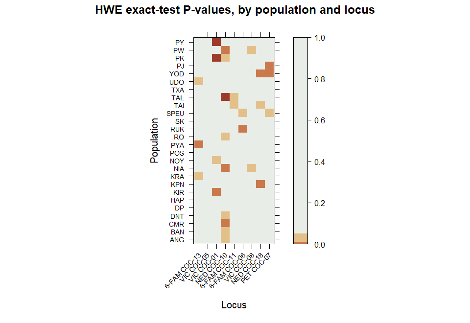<!-- -->

> Mostly pale cells, with a few dark ones. One locus has more dark cells
> than the others.

Counting the significant results by locus and by population, from the
handout’s *Think it through* box:

``` r
sort(rowSums(rw_hwe_mat < 0.05, na.rm = TRUE), decreasing = TRUE)   # by locus
```

    ##   NED COC-10   VIC COC-01 6-FAM COC-13   NED COC-18   PET COC-07 6-FAM COC-11 
    ##            9            4            3            3            3            2 
    ## 6-FAM COC-06   VIC COC-08   VIC COC-05 
    ##            2            2            0

``` r
sort(colSums(rw_hwe_mat < 0.05, na.rm = TRUE), decreasing = TRUE)   # by population
```

    ##  NIA SPEU  TAI  TAL  YOD   PK   PW  ANG  BAN  CMR  DNT  KIR  KPN  KRA  NOY  PYA 
    ##    2    2    2    2    2    2    2    1    1    1    1    1    1    1    1    1 
    ##   RO  RUK  UDO   PJ   PY   DP  HAP  POS   SK  TXA 
    ##    1    1    1    1    1    0    0    0    0    0

> No population has more than 2 significant loci. But `NED COC-10` is
> significant in 9 of the 26 populations, three times more than any
> other locus.

# Station 3 · Are your 9 loci 9 independent markers?

## 3.1 Test for association among loci across the whole dataset

``` r
set.seed(2026)                  # sample = 199 shuffles, so seed it
ia(rosewood, sample = 199)
```

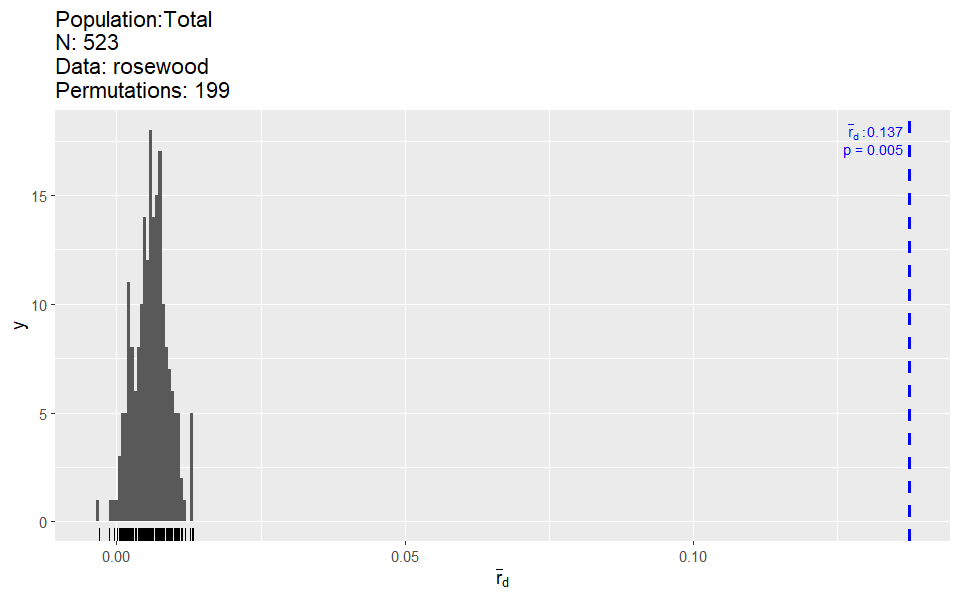<!-- -->

    ##        Ia      p.Ia     rbarD      p.rD 
    ## 1.0929369 0.0050000 0.1374233 0.0050000

> rbarD = 0.137, p = 0.005 (significant).

## 3.2 Run the same test inside a single population

``` r
set.seed(2026)
ia(popsub(rosewood, "PY"), sample = 199)      # popsub() keeps just one population; PY is the largest, n = 33
```

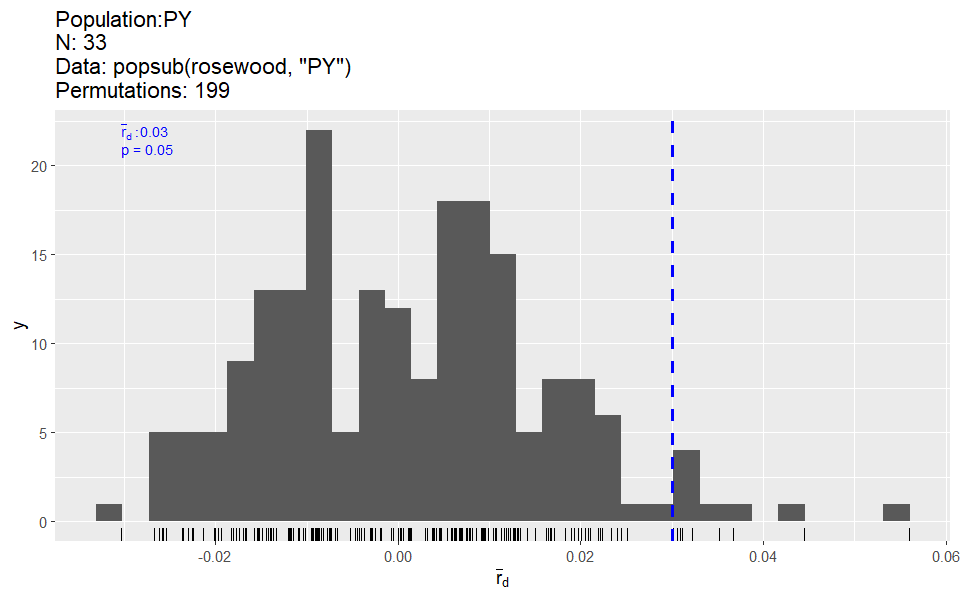<!-- -->

    ##         Ia       p.Ia      rbarD       p.rD 
    ## 0.22080537 0.05000000 0.02998134 0.05000000

> rbarD = 0.030, p = 0.05 — more than four times smaller than the pooled
> value.

## 3.3 Find the strongest pair, and read the effect size

``` r
rw_pair <- pair.ia(rosewood)
nrow(rw_pair)                       # how many pairs is that?
```

    ## [1] 36

``` r
head(round(rw_pair[order(-rw_pair[, "rbarD"]), ], 3))
```

    ##                              Ia rbarD
    ## 6-FAM COC-06:PET COC-07   0.255 0.257
    ## 6-FAM COC-11:6-FAM COC-06 0.255 0.255
    ## NED COC-18:PET COC-07     0.210 0.215
    ## NED COC-10:PET COC-07     0.199 0.205
    ## 6-FAM COC-11:PET COC-07   0.204 0.205
    ## NED COC-10:6-FAM COC-06   0.199 0.200

> 36 pairs. The strongest is `6-FAM COC-06` with `PET COC-07` (0.257),
> then `6-FAM COC-11` with `6-FAM COC-06` (0.255). All other pairs are
> below 0.22.

# Station 4 · Count carefully, then correct for effort

## 4.1 Count alleles per population

``` r
# rw_sum$pop.n.all is alleles per population; rw_sum$n.by.pop is trees per population
rw_sum <- summary(rosewood)

par(mar = c(6, 4.5, 2, 1))
barplot(sort(rw_sum$pop.n.all, decreasing = TRUE), las = 2, cex.names = 0.75,
        ylab = "Alleles counted (not corrected for sample size)")
```

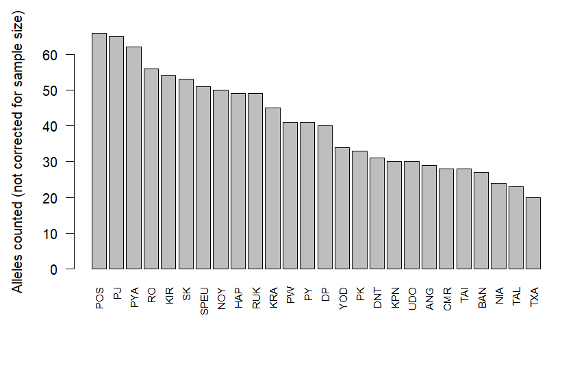<!-- -->

> `POS` has the most alleles (66) and `TXA` the fewest (20).

## 4.2 Check whether sample size explains the differences

``` r
d <- data.frame(pop     = names(rw_sum$pop.n.all),
                n       = as.numeric(rw_sum$n.by.pop),
                alleles = as.numeric(rw_sum$pop.n.all))

plot(d$n, d$alleles, pch = 19, col = "#1D6B56",
     xlab = "Trees sampled", ylab = "Alleles counted")
fit <- lm(alleles ~ n, data = d)
abline(fit, col = "#9C3B2C", lwd = 2)
```

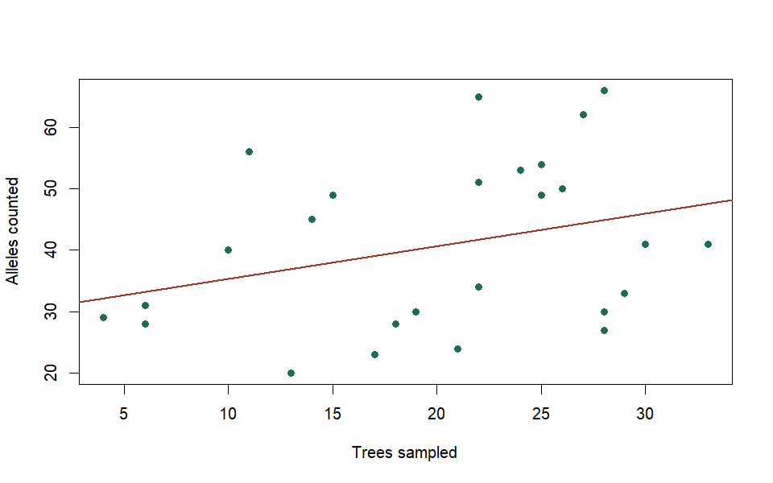<!-- -->

``` r
summary(fit)
```

    ## 
    ## Call:
    ## lm(formula = alleles ~ n, data = d)
    ## 
    ## Residuals:
    ##     Min      1Q  Median      3Q     Max 
    ## -17.927 -11.238  -2.686   9.968  23.266 
    ## 
    ## Coefficients:
    ##             Estimate Std. Error t value Pr(>|t|)    
    ## (Intercept)  30.0245     7.0478   4.260 0.000273 ***
    ## n             0.5322     0.3256   1.634 0.115214    
    ## ---
    ## Signif. codes:  0 '***' 0.001 '**' 0.01 '*' 0.05 '.' 0.1 ' ' 1
    ## 
    ## Residual standard error: 13.26 on 24 degrees of freedom
    ## Multiple R-squared:  0.1002, Adjusted R-squared:  0.06267 
    ## F-statistic: 2.671 on 1 and 24 DF,  p-value: 0.1152

> A weak positive trend with a lot of scatter, and it is *not*
> significant (p = 0.115). That does not mean sample size is harmless —
> task 4.4 removes the bias rather than testing for it again.

## 4.3 Convert to the hierfstat format

``` r
rw_hfstat <- genind2hierfstat(rosewood)
dim(rw_hfstat)             # 523 rows; column 1 is population, then one per locus
```

    ## [1] 523  10

## 4.4 Compute rarefied allelic richness

``` r
rw_ar <- allelic.richness(rw_hfstat)
rw_ar$min.all                           # the common number of gene copies used
```

    ## [1] 8

``` r
rw_pop_ar <- colMeans(rw_ar$Ar, na.rm = TRUE)

d$richness <- rw_pop_ar[d$pop]
cor(d$n, d$alleles)        # raw counts vs sample size
```

    ## [1] 0.3164828

``` r
cor(d$n, d$richness)       # rarefied richness vs sample size
```

    ## [1] -0.04313497

``` r
# Rank the populations twice and see what moved. A positive "move" means the
# population climbed once every population was compared at 8 gene copies.
d$rank_raw  <- rank(-d$alleles,  ties.method = "first")
d$rank_rare <- rank(-d$richness, ties.method = "first")
d$move      <- d$rank_raw - d$rank_rare

d[order(-d$move), c("pop", "n", "alleles", "rank_raw", "richness", "rank_rare", "move")]
```

<div class="kable-table">

|     | pop  |   n | alleles | rank_raw | richness | rank_rare | move |
|:----|:-----|----:|--------:|---------:|---------:|----------:|-----:|
| 1   | ANG  |   4 |      29 |       20 | 3.222222 |        13 |    7 |
| 3   | CMR  |   6 |      28 |       21 | 2.729068 |        15 |    6 |
| 15  | RUK  |  15 |      49 |       10 | 3.748723 |         5 |    5 |
| 4   | DNT  |   6 |      31 |       17 | 3.052525 |        14 |    3 |
| 5   | DP   |  10 |      40 |       14 | 3.484261 |        11 |    3 |
| 9   | KRA  |  14 |      45 |       11 | 3.495570 |        10 |    1 |
| 13  | PYA  |  27 |      62 |        3 | 4.008758 |         2 |    1 |
| 14  | RO   |  11 |      56 |        4 | 3.972988 |         3 |    1 |
| 18  | TAI  |  18 |      28 |       22 | 2.331939 |        21 |    1 |
| 2   | BAN  |  28 |      27 |       23 | 2.233220 |        23 |    0 |
| 10  | NIA  |  21 |      24 |       24 | 2.198026 |        24 |    0 |
| 12  | POS  |  28 |      66 |        1 | 4.153833 |         1 |    0 |
| 17  | SPEU |  22 |      51 |        7 | 3.579594 |         7 |    0 |
| 19  | TAL  |  17 |      23 |       25 | 2.135658 |        25 |    0 |
| 20  | TXA  |  13 |      20 |       26 | 1.959072 |        26 |    0 |
| 7   | KIR  |  25 |      54 |        5 | 3.580188 |         6 |   -1 |
| 11  | NOY  |  26 |      50 |        8 | 3.521492 |         9 |   -1 |
| 21  | UDO  |  28 |      30 |       19 | 2.358801 |        20 |   -1 |
| 16  | SK   |  24 |      53 |        6 | 3.528674 |         8 |   -2 |
| 22  | YOD  |  22 |      34 |       15 | 2.615279 |        17 |   -2 |
| 23  | PJ   |  22 |      65 |        2 | 3.776030 |         4 |   -2 |
| 6   | HAP  |  25 |      49 |        9 | 3.377126 |        12 |   -3 |
| 24  | PK   |  29 |      33 |       16 | 2.498697 |        19 |   -3 |
| 26  | PY   |  33 |      41 |       13 | 2.637964 |        16 |   -3 |
| 8   | KPN  |  19 |      30 |       18 | 2.284698 |        22 |   -4 |
| 25  | PW   |  30 |      41 |       12 | 2.607203 |        18 |   -6 |

</div>

> `rw_ar$min.all` = 8 gene copies. The correlation with sample size
> drops from 0.317 to −0.043. ANG climbs 7 places (20th to 13th) on its
> 4 trees, PW falls 6 on its 30, and six populations do not move at all.
> The biggest climbers are the smallest samples and the biggest fallers
> the largest; shifts of one place are just noise.

## 4.5 Get heterozygosity and FIS per population

``` r
rw_pop_stat <- basic.stats(rw_hfstat, diploid = TRUE, digits = 3)
rw_pop_stat$Ho[1:3, 1:4]        # a locus x population matrix, not one number per population
```

    ##                ANG   BAN   CMR DNT
    ## X6.FAM.COC.13 0.75 0.571 0.833 0.8
    ## VIC.COC.05    1.00 0.786 0.500 0.0
    ## VIC.COC.01    0.50 0.679 0.400 0.0

``` r
# For each population, we take the means to compute a population-level Ho, Hs, and Fis
rw_pop_ho  <- colMeans(rw_pop_stat$Ho,  na.rm = TRUE)
rw_pop_hs  <- colMeans(rw_pop_stat$Hs,  na.rm = TRUE)
rw_pop_fis <- colMeans(rw_pop_stat$Fis, na.rm = TRUE)

mean(rw_pop_hs)                 # compare with the published value for this species
```

    ## [1] 0.5684615

``` r
rw_pop_stat$overall
```

    ##    Ho    Hs    Ht   Dst   Htp  Dstp   Fst  Fstp   Fis  Dest 
    ## 0.562 0.568 0.754 0.186 0.762 0.193 0.247 0.254 0.010 0.448

**Ho** is observed heterozygosity and **He** is expected heterozygosity.
He depends on which trees you count as one population, so R gives it at
two levels: `Hs` is He within each population and `Ht` is He for all 523
trees pooled. FIS = 1 − Ho/Hs, and FST = 1 − Hs/Ht.

> Mean Ho = 0.562, mean Hs = 0.569, mean FIS = 0.020. `Ht` is 0.754,
> much higher than Hs, giving FST = 0.247 — the Wahlund effect in the
> real data.

## 4.6 Bootstrap a confidence interval for FIS

``` r
set.seed(2026)                  # nboot = 1000 resamples, so seed it
fis_ci <- boot.ppfis(rw_hfstat, nboot = 1000)$fis.ci   # columns: lower limit, upper limit

# boot.ppfis() returns 26 rows with no population names attached. This is the
# order they follow, so you can join them to the right populations in 4.7.
pop_order <- levels(factor(rw_hfstat$pop))

# A forest plot: the dot is FIS, the line is its interval. Sort by FIS so the
# plot reads bottom to top, and colour the populations with very few trees.
o   <- order(rw_pop_fis[pop_order])
nby <- as.numeric(rw_sum$n.by.pop[pop_order])
col <- ifelse(nby <= 6, "#9C3B2C", "#1D6B56")

par(mar = c(4.5, 5.5, 1, 1))
plot(rw_pop_fis[pop_order][o], seq_along(o), pch = 19, col = col[o],
     xlim = range(fis_ci), yaxt = "n", ylab = "",
     xlab = "FIS, with its 95% bootstrap confidence interval")
segments(fis_ci[o, 1], seq_along(o), fis_ci[o, 2], seq_along(o), col = col[o], lwd = 2)
axis(2, at = seq_along(o), labels = paste0(pop_order[o], " (", nby[o], ")"),
     las = 1, cex.axis = 0.7)
abline(v = 0, lty = 2)          # FIS = 0 is random mating
legend("bottomright", c("6 trees or fewer", "more than 6 trees"),
       col = c("#9C3B2C", "#1D6B56"), lwd = 2, bty = "n", cex = 0.8)
```

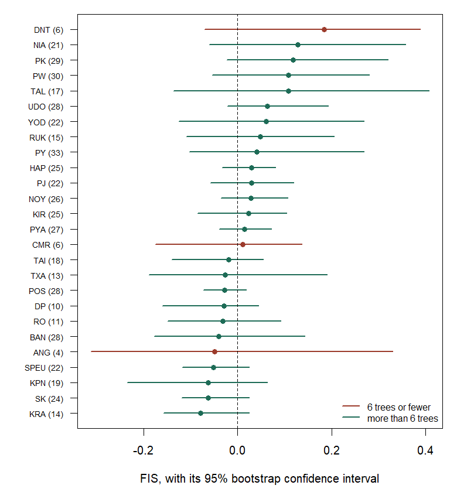<!-- -->

> Every interval crosses the dashed line at 0, so no population departs
> significantly from random mating. Read the widths rather than the
> verdict: ANG’s interval is 0.64 wide on 4 trees, POS’s only 0.09 on
> 28. Sample size is not the whole story, though: TAL has the second
> widest interval on 17 trees. DNT has the highest FIS (0.18) and KRA
> the lowest (−0.08).

## 4.7 Combine the results into one table

``` r
rw_table <- data.frame(
  pop      = pop_order,
  n        = as.numeric(rw_sum$n.by.pop[pop_order]),
  alleles  = as.numeric(rw_sum$pop.n.all[pop_order]),
  richness = round(rw_pop_ar[pop_order],  2),
  Ho       = round(rw_pop_ho[pop_order],  3),
  He       = round(rw_pop_hs[pop_order],  3),   # because this is the population-level He, hierfstat calls this Hs
  Fis      = round(rw_pop_fis[pop_order], 3),
  Fis_lo   = round(fis_ci[, 1], 3),
  Fis_hi   = round(fis_ci[, 2], 3),
  row.names = NULL
)

rw_table
```

<div class="kable-table">

| pop  |   n | alleles | richness |    Ho |    He |    Fis | Fis_lo | Fis_hi |
|:-----|----:|--------:|---------:|------:|------:|-------:|-------:|-------:|
| ANG  |   4 |      29 |     3.22 | 0.722 | 0.704 | -0.049 | -0.313 |  0.329 |
| BAN  |  28 |      27 |     2.23 | 0.453 | 0.434 | -0.041 | -0.177 |  0.143 |
| CMR  |   6 |      28 |     2.73 | 0.526 | 0.509 |  0.011 | -0.175 |  0.137 |
| DNT  |   6 |      31 |     3.05 | 0.441 | 0.509 |  0.184 | -0.071 |  0.389 |
| DP   |  10 |      40 |     3.48 | 0.678 | 0.642 | -0.029 | -0.160 |  0.044 |
| HAP  |  25 |      49 |     3.38 | 0.627 | 0.636 |  0.029 | -0.033 |  0.081 |
| KIR  |  25 |      54 |     3.58 | 0.656 | 0.651 |  0.023 | -0.085 |  0.104 |
| KPN  |  19 |      30 |     2.28 | 0.450 | 0.404 | -0.062 | -0.234 |  0.063 |
| KRA  |  14 |      45 |     3.50 | 0.691 | 0.645 | -0.079 | -0.157 |  0.025 |
| NIA  |  21 |      24 |     2.20 | 0.394 | 0.442 |  0.128 | -0.060 |  0.357 |
| NOY  |  26 |      50 |     3.52 | 0.654 | 0.673 |  0.028 | -0.035 |  0.107 |
| POS  |  28 |      66 |     4.15 | 0.786 | 0.767 | -0.027 | -0.073 |  0.018 |
| PYA  |  27 |      62 |     4.01 | 0.716 | 0.729 |  0.014 | -0.040 |  0.071 |
| RO   |  11 |      56 |     3.97 | 0.717 | 0.690 | -0.031 | -0.149 |  0.092 |
| RUK  |  15 |      49 |     3.75 | 0.688 | 0.723 |  0.048 | -0.108 |  0.205 |
| SK   |  24 |      53 |     3.53 | 0.681 | 0.650 | -0.063 | -0.118 |  0.025 |
| SPEU |  22 |      51 |     3.58 | 0.697 | 0.663 | -0.052 | -0.118 |  0.025 |
| TAI  |  18 |      28 |     2.33 | 0.463 | 0.445 | -0.019 | -0.140 |  0.054 |
| TAL  |  17 |      23 |     2.14 | 0.366 | 0.417 |  0.108 | -0.137 |  0.408 |
| TXA  |  13 |      20 |     1.96 | 0.362 | 0.357 | -0.026 | -0.189 |  0.190 |
| UDO  |  28 |      30 |     2.36 | 0.405 | 0.443 |  0.063 | -0.022 |  0.193 |
| YOD  |  22 |      34 |     2.62 | 0.470 | 0.510 |  0.060 | -0.125 |  0.269 |
| PJ   |  22 |      65 |     3.78 | 0.677 | 0.684 |  0.029 | -0.058 |  0.119 |
| PK   |  29 |      33 |     2.50 | 0.415 | 0.485 |  0.118 | -0.023 |  0.319 |
| PW   |  30 |      41 |     2.61 | 0.435 | 0.485 |  0.108 | -0.055 |  0.280 |
| PY   |  33 |      41 |     2.64 | 0.454 | 0.484 |  0.041 | -0.102 |  0.269 |

</div>

``` r
# Draw the table. Both panels use the same population order, sorted by He, so
# you can read straight across from one to the other.
o <- order(rw_table$He)
y <- seq_len(nrow(rw_table))

par(mfrow = c(1, 2), mar = c(4.5, 5, 3, 1))

plot(rw_table$richness[o], y, pch = 19, col = "#1D6B56", yaxt = "n", ylab = "",
     xlab = "Rarefied allelic richness", main = "Diversity corrected for effort")
axis(2, at = y, labels = rw_table$pop[o], las = 1, cex.axis = 0.7)

# The grey bar is the distance between Ho and He. FIS = 1 - Ho/He, so a red dot
# to the LEFT of its blue one (Ho below He) is a positive FIS.
plot(rw_table$He[o], y, type = "n", xlim = range(c(rw_table$Ho, rw_table$He)),
     yaxt = "n", ylab = "", xlab = "Heterozygosity", main = "Ho against He")
segments(rw_table$Ho[o], y, rw_table$He[o], y, col = "grey80", lwd = 3)
points(rw_table$Ho[o], y, pch = 19, col = "#9C3B2C")
points(rw_table$He[o], y, pch = 19, col = "#2E6A99")
axis(2, at = y, labels = rw_table$pop[o], las = 1, cex.axis = 0.7)
legend("topleft", c("Ho observed", "He expected"), col = c("#9C3B2C", "#2E6A99"),
       pch = 19, bty = "n", cex = 0.8)
```

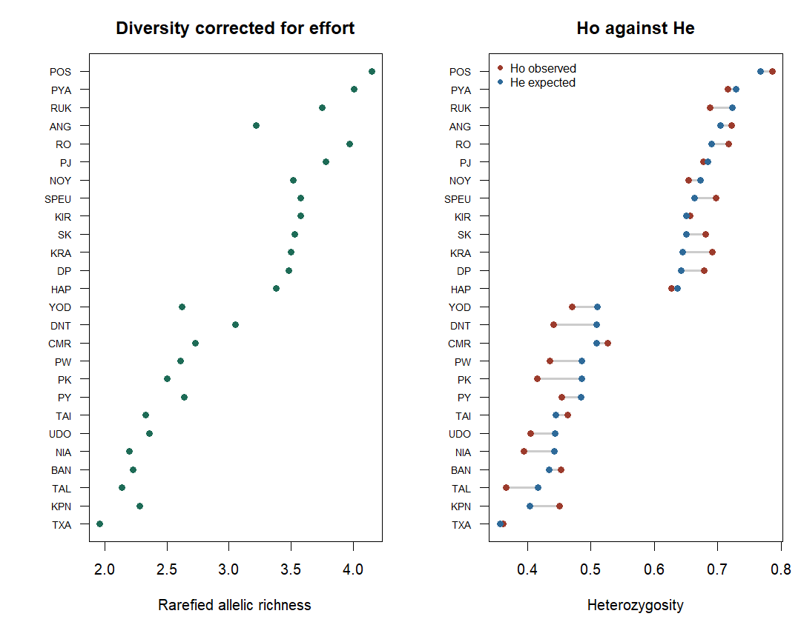<!-- -->

``` r
par(mfrow = c(1, 1))            # back to one panel per plot
```

> 26 rows and no missing values. The two diversity measures mostly agree
> (r = 0.97), so the left panel falls away steadily — but ANG is 4th on
> He and only 13th on richness, which is what 4 trees buys you. The
> right panel splits the populations into two bands: 13 sit at He 0.64
> to 0.77 and 13 at 0.36 to 0.51, with nothing in between. Every
> population north of 16°N is in the lower band. Hold on to that for
> Station 5.
>
> Which populations have the higher genetic diversity, in rarefied
> richness, Ho or He?

## 4.8 Interpret the difference between Ho and He

``` r
rw_table[rw_table$pop == "NIA", ]
```

<div class="kable-table">

|     | pop |   n | alleles | richness |    Ho |    He |   Fis | Fis_lo | Fis_hi |
|:----|:----|----:|--------:|---------:|------:|------:|------:|-------:|-------:|
| 10  | NIA |  21 |      24 |      2.2 | 0.394 | 0.442 | 0.128 |  -0.06 |  0.357 |

</div>

> NIA: Ho = 0.394, He = 0.442, FIS = 0.128 (95% CI −0.060 to 0.357).

# Station 5 · Structure

## 5.1 Measure how different each pair of populations is

``` r
fst_dist <- genet.dist(rw_hfstat, method = "WC84")   # Weir & Cockerham 1984
fst <- as.matrix(fst_dist)            # a 26 x 26 matrix

pairs <- fst[lower.tri(fst)]          # the 325 unique pairs
range(pairs); mean(pairs)             # compare the mean with the published GST = 0.25
```

    ## [1] -0.004399626  0.449403308

    ## [1] 0.2473326

``` r
print(levelplot(fst, xlab = "", ylab = "",
      main = "Pairwise FST (Weir & Cockerham)",
      scales = list(x = list(rot = 90, cex = 0.6), y = list(cex = 0.6)),
      col.regions = colorRampPalette(c("#E8EDE8", "#E3C08A", "#C9794B", "#9C3B2C"))(100)))
```

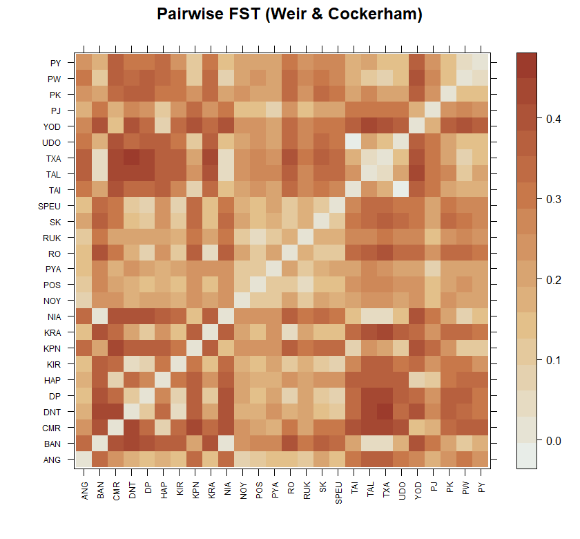<!-- -->

> 325 pairs. The mean FST is 0.247. Values range from −0.004 to 0.449
> (TXA and DNT).

## 5.2 Test whether genetic differences increase with distance

``` r
rw_coords <- read.csv("rosewood_coords.csv", row.names = 1)   # column 1 longitude, column 2 latitude

common <- intersect(rownames(fst), rownames(rw_coords))
length(common)                        # must be 26
```

    ## [1] 26

``` r
fst_m <- fst[common, common]
geo_m <- as.matrix(dist(rw_coords[common, 1:2]))

plot(geo_m[lower.tri(geo_m)], fst_m[lower.tri(fst_m)],
     pch = 19, col = "#1D6B5655",
     xlab = "Geographic distance between the pair (degrees)",
     ylab = "Pairwise FST")
abline(lm(fst_m[lower.tri(fst_m)] ~ geo_m[lower.tri(geo_m)]), col = "#9C3B2C", lwd = 2)
```

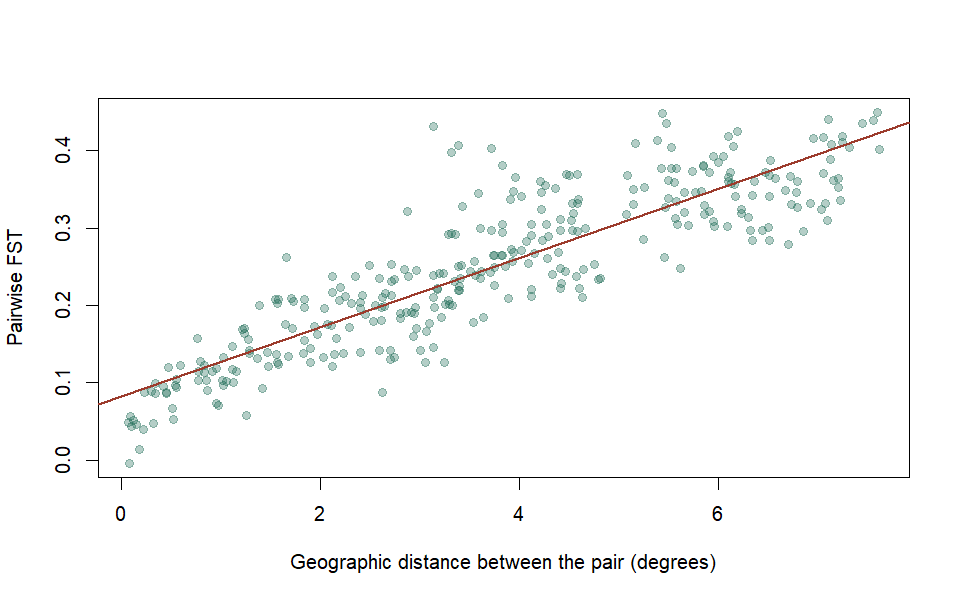<!-- -->

``` r
set.seed(2026)                  # nrepet = 999 shuffles, so seed it
mantel.randtest(as.dist(fst_m), as.dist(geo_m), nrepet = 999)
```

    ## Monte-Carlo test
    ## Call: mantel.randtest(m1 = as.dist(fst_m), m2 = as.dist(geo_m), nrepet = 999)
    ## 
    ## Observation: 0.8797672 
    ## 
    ## Based on 999 replicates
    ## Simulated p-value: 0.001 
    ## Alternative hypothesis: greater 
    ## 
    ##      Std.Obs  Expectation     Variance 
    ## 14.426342909  0.000559858  0.003714241

> Observation = 0.880 and p = 0.001. FST increases by about 0.04 for
> every 100 km.

## 5.3 Choose the number of clusters (K)

This is the line you run in the practical. R draws the BIC graph, asks
`Choose the number of clusters (>=2):`, and you type `5`:

``` r
set.seed(2026)                  # clustering starts from random seeds, so seed it
# n.pca = 150 keeps all the genetic information; you do not need to change it
grp <- find.clusters(rosewood, max.n.clust = 20, n.pca = 150)

# R now draws the BIC graph and asks:
#   Choose the number of clusters (>=2):
# Type 5 and press Enter.

table(grp$grp)                  # how many trees in each cluster?
```

When knitting there is nobody at the keyboard, so the chunk below
answers `5` for you. It gives exactly the same clusters as typing it.

``` r
options(adegenet.testcon = textConnection("5"))   # stands in for typing 5
set.seed(2026)
grp <- find.clusters(rosewood, max.n.clust = 20, n.pca = 150)
```

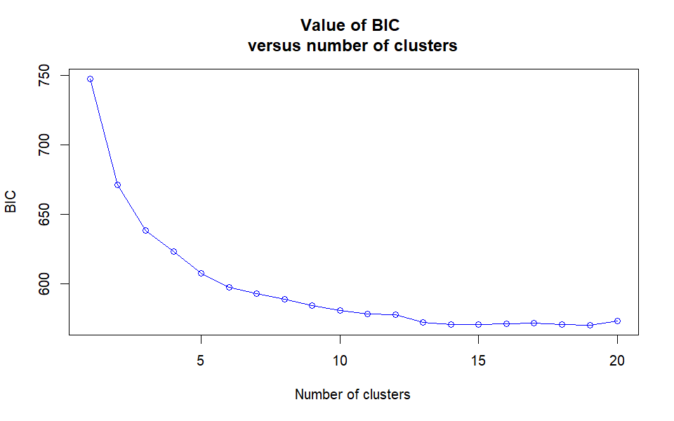<!-- -->

    ## Choose the number of clusters (>=2):

``` r
options(adegenet.testcon = stdin())               # back to normal

table(grp$grp)
```

    ## 
    ##   1   2   3   4   5 
    ## 101 111 119  54 138

> Five clusters with 101, 111, 119, 54 and 138 trees.

## 5.4 Check how clusters relate to the sampled populations

``` r
tab <- table(pop(rosewood), grp$grp)
tab                             # populations x clusters
```

    ##       
    ##         1  2  3  4  5
    ##   ANG   0  2  2  0  0
    ##   BAN   0  0  0  0 28
    ##   CMR   0  0  0  6  0
    ##   DNT   0  0  6  0  0
    ##   DP    0  0 10  0  0
    ##   HAP   0  1  0 24  0
    ##   KIR   0  0 25  0  0
    ##   KPN  17  0  0  0  2
    ##   KRA   0  0 14  0  0
    ##   NIA   2  0  0  0 19
    ##   NOY   1 22  1  0  2
    ##   POS   1 24  3  0  0
    ##   PYA   0 27  0  0  0
    ##   RO    0  0 11  0  0
    ##   RUK   0 15  0  0  0
    ##   SK    0  0 24  0  0
    ##   SPEU  0  0 22  0  0
    ##   TAI  17  0  0  0  1
    ##   TAL   0  0  0  0 17
    ##   TXA   3  0  0  0 10
    ##   UDO  24  0  0  0  4
    ##   YOD   0  0  0 22  0
    ##   PJ    0 20  0  2  0
    ##   PK   12  0  0  0 17
    ##   PW    7  0  0  0 23
    ##   PY   17  0  1  0 15

``` r
rowSums(tab > 0)                # how many clusters does each population contain?
```

    ##  ANG  BAN  CMR  DNT   DP  HAP  KIR  KPN  KRA  NIA  NOY  POS  PYA   RO  RUK   SK 
    ##    2    1    1    1    1    2    1    2    1    2    4    3    1    1    1    1 
    ## SPEU  TAI  TAL  TXA  UDO  YOD   PJ   PK   PW   PY 
    ##    1    2    1    2    2    1    2    2    2    3

> 13 populations fall completely into one cluster; the other 13 contain
> trees from more than one. PK splits 12 and 17; PY splits 17 and 15,
> plus one stray tree.

## 5.5 Run the DAPC

``` r
rw_dapc <- dapc(rosewood, grp$grp, n.pca = 50, n.da = 4)
rw_dapc
```

    ##  #################################################
    ##  # Discriminant Analysis of Principal Components #
    ##  #################################################
    ## class: dapc
    ## $call: dapc.genind(x = rosewood, pop = grp$grp, n.pca = 50, n.da = 4)
    ## 
    ## $n.pca: 50 first PCs of PCA used
    ## $n.da: 4 discriminant functions saved
    ## $var (proportion of conserved variance): 0.927
    ## 
    ## $eig (eigenvalues): 1665 935.3 365.2 256.8  vector    length content                   
    ## 1 $eig      4      eigenvalues               
    ## 2 $grp      523    prior group assignment    
    ## 3 $prior    5      prior group probabilities 
    ## 4 $assign   523    posterior group assignment
    ## 5 $pca.cent 133    centring vector of PCA    
    ## 6 $pca.norm 133    scaling vector of PCA     
    ## 7 $pca.eig  123    eigenvalues of PCA        
    ## 
    ##   data.frame    nrow ncol content                                          
    ## 1 $tab          523  50   retained PCs of PCA                              
    ## 2 $means        5    50   group means                                      
    ## 3 $loadings     50   4    loadings of variables                            
    ## 4 $ind.coord    523  4    coordinates of individuals (principal components)
    ## 5 $grp.coord    5    4    coordinates of groups                            
    ## 6 $posterior    523  5    posterior membership probabilities               
    ## 7 $pca.loadings 133  50   PCA loadings of original variables               
    ## 8 $var.contr    133  4    contribution of original variables

## 5.6 Plot the clusters, with a legend

``` r
K <- 5
clust_cols <- brewer.pal(K, "Set2")

scatter(rw_dapc, col = clust_cols, cex = 1.1,
        scree.da = TRUE, scree.pca = TRUE, posi.pca = "bottomleft",
        legend = TRUE, posi.leg = "topright", cleg = 0.8)
```

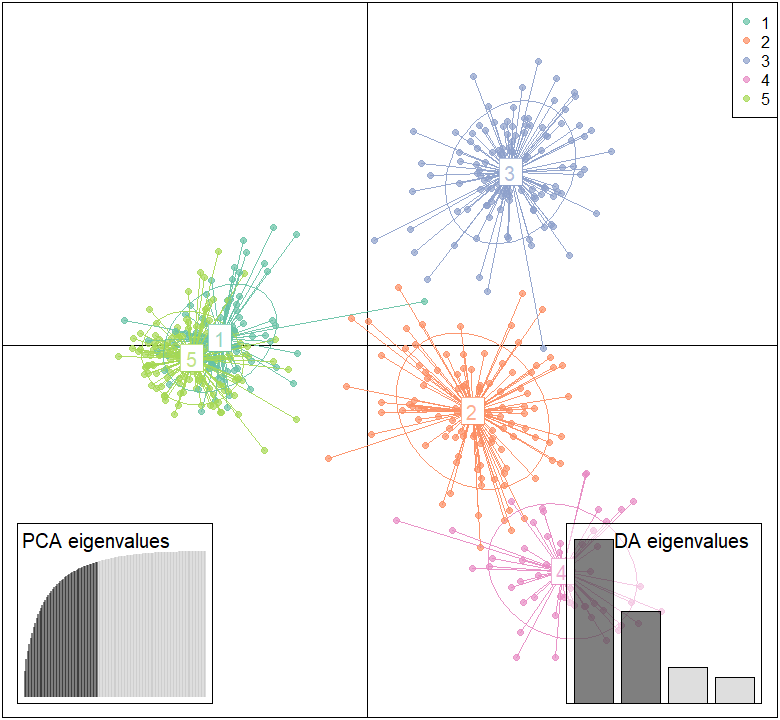<!-- -->

## 5.7 Work out cluster membership for each population and map it

``` r
postprobs <- as.data.frame(rw_dapc$posterior)   # one row per tree, one column per cluster

rw_pops <- pop(rosewood)
qpop <- t(sapply(levels(rw_pops),
                 function(p) colMeans(postprobs[rw_pops == p, , drop = FALSE])))
```

`qpop` is in alphabetical order and `rw_coords` need not be, so match
them **by name**. Get this wrong and R will not warn you; it will just
draw the wrong pie on the wrong population.

``` r
qpop <- qpop[rownames(rw_coords), ]             # align by name, not by position
round(qpop, 3)
```

    ##          1     2     3     4     5
    ## ANG  0.000 0.540 0.460 0.000 0.000
    ## BAN  0.001 0.000 0.000 0.000 0.999
    ## CMR  0.000 0.000 0.000 1.000 0.000
    ## DNT  0.000 0.000 1.000 0.000 0.000
    ## DP   0.000 0.000 1.000 0.000 0.000
    ## HAP  0.000 0.061 0.000 0.939 0.000
    ## KIR  0.000 0.000 1.000 0.000 0.000
    ## KPN  0.859 0.000 0.000 0.000 0.141
    ## KRA  0.000 0.000 1.000 0.000 0.000
    ## NIA  0.070 0.000 0.000 0.000 0.930
    ## NOY  0.044 0.884 0.014 0.000 0.058
    ## POS  0.001 0.960 0.040 0.000 0.000
    ## PYA  0.000 1.000 0.000 0.000 0.000
    ## RO   0.000 0.000 1.000 0.000 0.000
    ## RUK  0.066 0.934 0.000 0.000 0.000
    ## SK   0.000 0.000 1.000 0.000 0.000
    ## SPEU 0.000 0.000 1.000 0.000 0.000
    ## TAI  0.952 0.000 0.000 0.000 0.048
    ## TAL  0.000 0.000 0.000 0.000 1.000
    ## TXA  0.152 0.000 0.000 0.000 0.848
    ## UDO  0.860 0.000 0.000 0.000 0.140
    ## YOD  0.000 0.000 0.000 1.000 0.000
    ## PJ   0.000 0.954 0.000 0.046 0.000
    ## PK   0.416 0.000 0.000 0.000 0.584
    ## PW   0.203 0.000 0.000 0.000 0.797
    ## PY   0.508 0.000 0.030 0.000 0.462

> PYA, TAL, CMR and YOD are all 1.000. PK splits 0.416 / 0.584, PY 0.508
> / 0.462, and ANG 0.540 / 0.460 on only 4 trees.

``` r
clust_cols <- brewer.pal(K, "Set2")

plot(rw_coords[, 1], rw_coords[, 2], type = "n", asp = 1,
     xlab = "Longitude (degrees E)", ylab = "Latitude (degrees N)",
     main = "DAPC cluster membership, K = 5")
maps::map(add = TRUE, col = "grey90", fill = TRUE, border = "grey70")

# Rivers and lakes (Natural Earth 1:10m, clipped to this region)
water  <- read.csv("rosewood_water.csv")
lakes  <- water[water$type == "lake", ]
rivers <- water[water$type == "river", ]
polygon(lakes$lon, lakes$lat, col = "#A9CCE3", border = NA)
lines(rivers$lon, rivers$lat, col = "#5B8DB8", lwd = 1.2)
mekong <- rivers[rivers$name == "Mekong", ]
lines(mekong$lon, mekong$lat, col = "#2E6A99", lwd = 3)       # the Mekong, drawn thicker
text(c(106.1, 103.4), c(15.95, 12.85), c("Mekong", "Tonle Sap"),
     col = "#2E6A99", cex = 0.7, font = 3)
box()

# Radius from the size of the plotted area, not from a magic number
r <- 0.03 * diff(range(rw_coords[, 1]))

for (i in seq_len(nrow(qpop))) {
  add.pie(z = qpop[i, ], x = rw_coords[i, 1], y = rw_coords[i, 2],
          labels = "", col = clust_cols, radius = r)
}

legend("bottomleft", legend = paste("Cluster", 1:K), fill = clust_cols,
       bty = "n", cex = 0.8, title = "DAPC cluster")
```

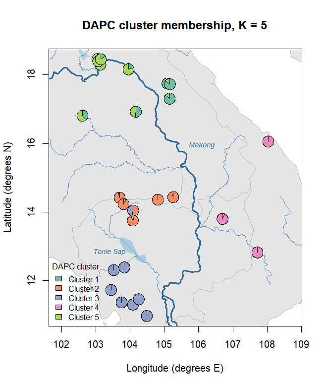<!-- -->

> Neighbouring populations mostly share the same colours, and a colour
> boundary follows the Mekong.

## 5.8 + optional · Check whether the clusters change with K

The handout asks you to re-run 5.3 to 5.7 with K = 3 and K = 7. Here
`n.clust` sets K directly, so there is nothing to type:

``` r
set.seed(2026)
grp3 <- find.clusters(rosewood, max.n.clust = 20, n.pca = 150,
                      n.clust = 3, choose.n.clust = FALSE)
set.seed(2026)
grp7 <- find.clusters(rosewood, max.n.clust = 20, n.pca = 150,
                      n.clust = 7, choose.n.clust = FALSE)

table(grp$grp, grp3$grp)        # which K=5 clusters merge at K=3?
```

    ##    
    ##       1   2   3
    ##   1 100   1   0
    ##   2   1  14  96
    ##   3   0 119   0
    ##   4   0   0  54
    ##   5 138   0   0

``` r
table(grp$grp, grp7$grp)        # which K=5 clusters split at K=7?
```

    ##    
    ##       1   2   3   4   5   6   7
    ##   1  31   0   0   1   0   0  69
    ##   2   0   0   1  63  47   0   0
    ##   3   0   0   0   4   0 115   0
    ##   4   0   0  50   0   4   0   0
    ##   5  39  96   0   1   0   0   2

> Clusters 3 and 4 stay almost the same. At K = 3, clusters 1 and 5
> merge; at K = 7, clusters 1, 2 and 5 each split in two.

# Station 6 · From science to conservation recommendations

Station 6 has no code. It uses the diversity table from 4.7 and the
cluster map from 5.7, both above.

``` r
sessionInfo()
```

    ## R version 4.5.1 (2025-06-13 ucrt)
    ## Platform: x86_64-w64-mingw32/x64
    ## Running under: Windows 11 x64 (build 26200)
    ## 
    ## Matrix products: default
    ##   LAPACK version 3.12.1
    ## 
    ## locale:
    ## [1] LC_COLLATE=English_United Kingdom.utf8 
    ## [2] LC_CTYPE=English_United Kingdom.utf8   
    ## [3] LC_MONETARY=English_United Kingdom.utf8
    ## [4] LC_NUMERIC=C                           
    ## [5] LC_TIME=English_United Kingdom.utf8    
    ## 
    ## time zone: Europe/London
    ## tzcode source: internal
    ## 
    ## attached base packages:
    ## [1] stats     graphics  grDevices utils     datasets  methods   base     
    ## 
    ## other attached packages:
    ##  [1] RColorBrewer_1.1-3 mapplots_1.5.3     maps_3.4.3         lattice_0.22-7    
    ##  [5] hierfstat_0.5-11   pegas_1.3          ape_5.8-1          poppr_2.9.8       
    ##  [9] adegenet_2.1.11    ade4_1.7-23       
    ## 
    ## loaded via a namespace (and not attached):
    ##  [1] generics_0.1.4    stringi_1.8.7     digest_0.6.37     magrittr_2.0.3   
    ##  [5] evaluate_1.0.4    grid_4.5.1        fastmap_1.2.0     seqinr_4.2-36    
    ##  [9] plyr_1.8.9        Matrix_1.7-3      promises_1.3.3    mgcv_1.9-3       
    ## [13] scales_1.4.0      permute_0.9-8     cli_3.6.5         shiny_1.11.1     
    ## [17] rlang_1.1.6       splines_4.5.1     withr_3.0.2       yaml_2.3.10      
    ## [21] vegan_2.7-1       tools_4.5.1       parallel_4.5.1    reshape2_1.4.4   
    ## [25] dplyr_1.1.4       ggplot2_3.5.2     httpuv_1.6.16     boot_1.3-31      
    ## [29] vctrs_0.6.5       R6_2.6.1          mime_0.13         lifecycle_1.0.4  
    ## [33] stringr_1.5.2     MASS_7.3-65       cluster_2.1.8.1   pkgconfig_2.0.3  
    ## [37] progressr_0.16.0  pillar_1.11.0     later_1.4.4       gtable_0.3.6     
    ## [41] glue_1.8.0        Rcpp_1.1.0        xfun_0.52         tibble_3.3.0     
    ## [45] tidyselect_1.2.1  knitr_1.50        farver_2.1.2      xtable_1.8-4     
    ## [49] htmltools_0.5.8.1 nlme_3.1-168      igraph_2.1.4      labeling_0.4.3   
    ## [53] rmarkdown_2.29    compiler_4.5.1    polysat_1.7-7
