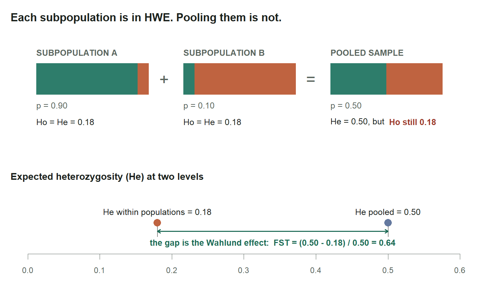
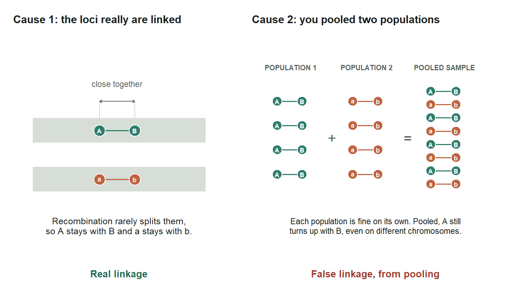
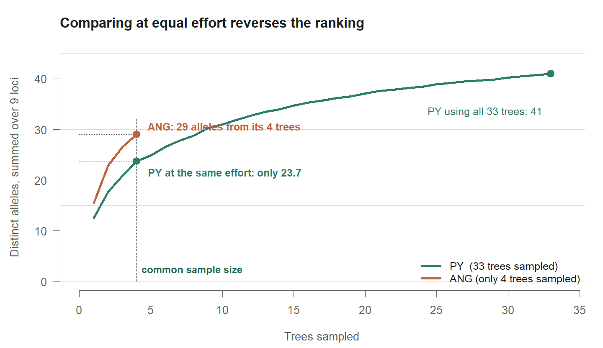
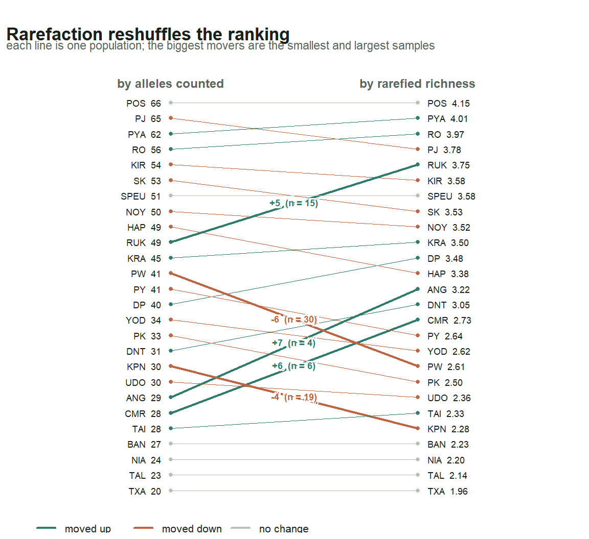
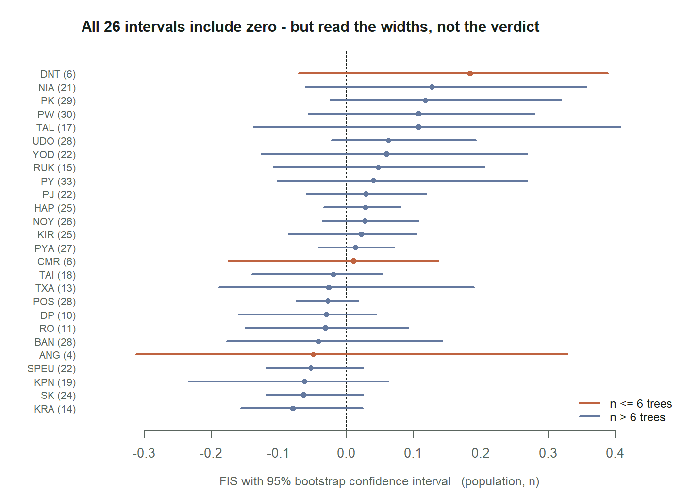
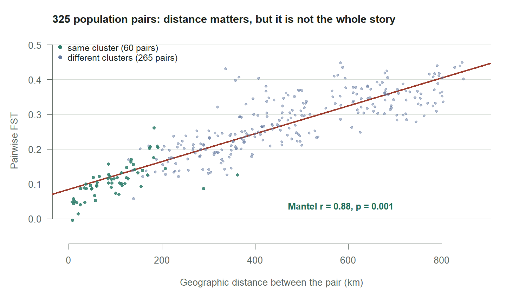
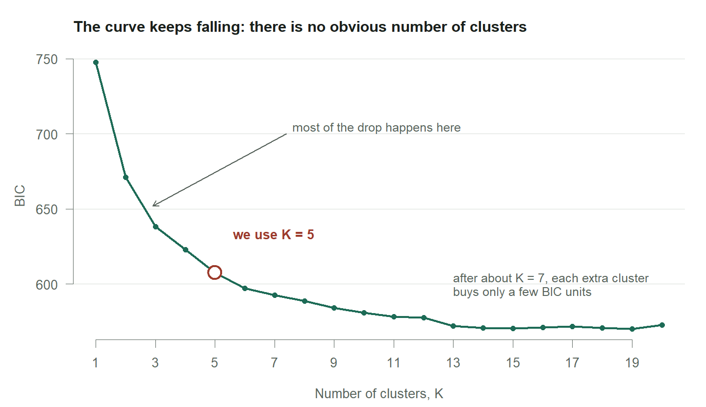
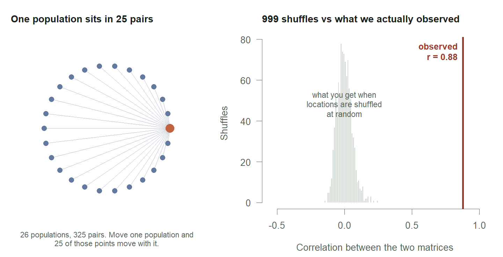

Activity 1: auxiliary figures and checks
================
Tin Hang Hung
2026-10-27

- [Setup](#setup)
- [Re-run the practical](#re-run-the-practical)
- [Checks against the handout](#checks-against-the-handout)
  - [Station 1](#station-1)
  - [Station 2](#station-2)
  - [Station 3](#station-3)
  - [Station 4](#station-4)
  - [Station 5](#station-5)
  - [Summary](#summary)
- [Teaching figures](#teaching-figures)
  - [The Wahlund effect (task 2.1, slide
    6)](#the-wahlund-effect-task-21-slide-6)
  - [Linkage disequilibrium: two causes (slide
    7)](#linkage-disequilibrium-two-causes-slide-7)
  - [Allele accumulation, PY vs ANG (task 4.4, slide
    8)](#allele-accumulation-py-vs-ang-task-44-slide-8)
  - [Rank change after rarefaction (task
    4.4)](#rank-change-after-rarefaction-task-44)
  - [FIS intervals for all 26 populations (task
    4.6)](#fis-intervals-for-all-26-populations-task-46)
  - [FST against distance, coloured by cluster (task
    5.2)](#fst-against-distance-coloured-by-cluster-task-52)
  - [The BIC curve (task 5.3)](#the-bic-curve-task-53)
  - [How the Mantel test works (task
    5.2)](#how-the-mantel-test-works-task-52)
- [Final tally](#final-tally)

This file does two jobs that are deliberately kept out of the student
practical:

1.  **Checks.** It re-runs the practical and compares every result with
    the number quoted in the handout’s *Expect to see* boxes. `PASS`
    means your machine reproduces the handout; `FAIL` shows both values.
2.  **Teaching figures.** It rebuilds the eight figures used on the
    Notion page and in the pre-practical slides, and writes them to
    `figures/`.

It needs the same three CSVs as the practical, in the same folder. It
takes a few minutes, because it repeats the whole analysis from scratch.

# Setup

``` r
pkgs <- c("poppr", "pegas", "hierfstat", "adegenet", "ade4",
          "lattice", "mapplots", "maps", "RColorBrewer")
missing <- pkgs[!pkgs %in% rownames(installed.packages())]
if (length(missing)) stop("Install these packages first: ", paste(missing, collapse = ", "))
invisible(lapply(pkgs, library, character.only = TRUE))
dir.create("figures", showWarnings = FALSE)

data.frame(package = pkgs,
           version = sapply(pkgs, function(p) as.character(packageVersion(p))),
           row.names = NULL)
```

<div class="kable-table">

| package      | version |
|:-------------|:--------|
| poppr        | 2.9.8   |
| pegas        | 1.3     |
| hierfstat    | 0.5.11  |
| adegenet     | 2.1.11  |
| ade4         | 1.7.23  |
| lattice      | 0.22.7  |
| mapplots     | 1.5.3   |
| maps         | 3.4.3   |
| RColorBrewer | 1.1.3   |

</div>

Built and checked with R 4.5.1, poppr 2.9.8, adegenet 2.1.11, hierfstat
0.5.11, pegas 1.3 and ade4 1.7.23.

``` r
# check(): compare a result with the value quoted in the handout
.checks <- data.frame(task = character(), label = character(), result = character())
check <- function(task, label, value, expected, tol = 0) {
  ok <- if (is.numeric(expected)) {
    length(value) == length(expected) && isTRUE(all(abs(value - expected) <= tol))
  } else identical(as.character(value), as.character(expected))
  cat(sprintf("%s  [%s] %s: got %s, handout says %s\n", if (ok) "PASS" else "FAIL", task, label,
              paste(format(value, digits = 4), collapse = " "),
              paste(format(expected, digits = 4), collapse = " ")))
  .checks[nrow(.checks) + 1, ] <<- c(task, label, if (ok) "PASS" else "FAIL")
  invisible(ok)
}
```

# Re-run the practical

Everything the checks and figures need, in one block, with the
practical’s seeds.

``` r
set.seed(2026)
rosewood <- read.genalex("rosewood.csv")

# Station 1
set.seed(2026)
gac    <- genotype_curve(rosewood, sample = 1000, quiet = TRUE)
rw_lt  <- locus_table(rosewood)
mt     <- info_table(rosewood, type = "missing", plot = FALSE)
pp     <- poppr(rosewood)
hexp   <- setNames(pp$Hexp, pp$Pop)

# Station 2
set.seed(2026)
rw_hwe_pop <- lapply(seppop(rosewood), hw.test, B = 1000)
rw_hwe_mat <- sapply(rw_hwe_pop, "[", i = TRUE, j = 3)
hwe_fdr    <- p.adjust(rw_hwe_mat, method = "BH")

# Station 3
set.seed(2026); ia_all <- ia(rosewood, sample = 199)
set.seed(2026); ia_py  <- ia(popsub(rosewood, "PY"), sample = 199)
rw_pair <- pair.ia(rosewood, quiet = TRUE)

# Station 4
rw_sum    <- summary(rosewood)
d         <- data.frame(pop = names(rw_sum$pop.n.all),
                        n = as.numeric(rw_sum$n.by.pop),
                        alleles = as.numeric(rw_sum$pop.n.all))
fit       <- lm(alleles ~ n, data = d)
rw_hfstat <- genind2hierfstat(rosewood)
rw_ar     <- allelic.richness(rw_hfstat)
rw_pop_ar <- colMeans(rw_ar$Ar, na.rm = TRUE)
d$richness  <- rw_pop_ar[d$pop]
rw_pop_stat <- basic.stats(rw_hfstat, diploid = TRUE, digits = 3)
rw_pop_ho   <- colMeans(rw_pop_stat$Ho,  na.rm = TRUE)
rw_pop_hs   <- colMeans(rw_pop_stat$Hs,  na.rm = TRUE)
rw_pop_fis  <- colMeans(rw_pop_stat$Fis, na.rm = TRUE)
set.seed(2026)
fis_ci    <- boot.ppfis(rw_hfstat, nboot = 1000)$fis.ci
pop_order <- levels(factor(rw_hfstat$pop))
rw_table  <- data.frame(
  pop = pop_order, n = as.numeric(rw_sum$n.by.pop[pop_order]),
  alleles = as.numeric(rw_sum$pop.n.all[pop_order]),
  richness = round(rw_pop_ar[pop_order], 2), Ho = round(rw_pop_ho[pop_order], 3),
  He = round(rw_pop_hs[pop_order], 3), Fis = round(rw_pop_fis[pop_order], 3),
  Fis_lo = round(fis_ci[, 1], 3), Fis_hi = round(fis_ci[, 2], 3), row.names = NULL)

# Station 5
fst       <- as.matrix(genet.dist(rw_hfstat, method = "WC84"))
rw_coords <- read.csv("rosewood_coords.csv", row.names = 1)
common    <- intersect(rownames(fst), rownames(rw_coords))
fst_m     <- fst[common, common]
geo_m     <- as.matrix(dist(rw_coords[common, 1:2]))
set.seed(2026)
mt_deg <- mantel.randtest(as.dist(fst_m), as.dist(geo_m), nrepet = 999)

options(adegenet.testcon = textConnection("5"))
set.seed(2026)
grp <- find.clusters(rosewood, max.n.clust = 20, n.pca = 150)
options(adegenet.testcon = stdin())

tab     <- table(pop(rosewood), grp$grp)
rw_dapc <- dapc(rosewood, grp$grp, n.pca = 50, n.da = 4)
rw_pops <- pop(rosewood)
qpop    <- t(sapply(levels(rw_pops),
                    function(p) colMeans(as.data.frame(rw_dapc$posterior)[rw_pops == p, , drop = FALSE])))
qpop    <- qpop[rownames(rw_coords), ]
set.seed(2026)
grp3 <- find.clusters(rosewood, max.n.clust = 20, n.pca = 150, n.clust = 3, choose.n.clust = FALSE)
set.seed(2026)
grp7 <- find.clusters(rosewood, max.n.clust = 20, n.pca = 150, n.clust = 7, choose.n.clust = FALSE)
bic  <- data.frame(K = seq_along(grp$Kstat), BIC = as.numeric(grp$Kstat))
```

# Checks against the handout

## Station 1

``` r
ns <- table(pop(rosewood))
check("1.2", "individuals", nInd(rosewood), 523)
```

    ## PASS  [1.2] individuals: got 523, handout says 523

``` r
check("1.2", "loci", nLoc(rosewood), 9)
```

    ## PASS  [1.2] loci: got 9, handout says 9

``` r
check("1.2", "populations", nPop(rosewood), 26)
```

    ## PASS  [1.2] populations: got 26, handout says 26

``` r
check("1.2", "smallest population", names(ns)[which.min(ns)], "ANG")
```

    ## PASS  [1.2] smallest population: got ANG, handout says ANG

``` r
check("1.2", "smallest n", min(ns), 4)
```

    ## PASS  [1.2] smallest n: got 4, handout says 4

``` r
check("1.2", "largest population", names(ns)[which.max(ns)], "PY")
```

    ## PASS  [1.2] largest population: got PY, handout says PY

``` r
check("1.2", "largest n", max(ns), 33)
```

    ## PASS  [1.2] largest n: got 33, handout says 33

``` r
check("1.3", "median genotypes, 1 locus", median(gac[, 1]), 60)
```

    ## PASS  [1.3] median genotypes, 1 locus: got 60, handout says 60

``` r
check("1.3", "median genotypes, 8 loci", median(gac[, ncol(gac)]), 520)
```

    ## PASS  [1.3] median genotypes, 8 loci: got 520, handout says 520

``` r
check("1.3", "distinct genotypes, all 9 loci", mlg(rosewood, quiet = TRUE), 523)
```

    ## PASS  [1.3] distinct genotypes, all 9 loci: got 523, handout says 523

``` r
ev <- setNames(rw_lt[rownames(rw_lt) != "mean", "Evenness"], rownames(rw_lt)[rownames(rw_lt) != "mean"])
al <- rw_lt[rownames(rw_lt) != "mean", "allele"]
check("1.4", "fewest alleles at a locus", min(al), 11)
```

    ## PASS  [1.4] fewest alleles at a locus: got 11, handout says 11

``` r
check("1.4", "most alleles at a locus", max(al), 17)
```

    ## PASS  [1.4] most alleles at a locus: got 17, handout says 17

``` r
check("1.4", "most even locus", names(which.max(ev)), "VIC COC-01")
```

    ## PASS  [1.4] most even locus: got VIC COC-01, handout says VIC COC-01

``` r
check("1.4", "highest evenness", round(max(ev), 2), 0.80)
```

    ## PASS  [1.4] highest evenness: got 0.8, handout says 0.8

``` r
check("1.4", "least even locus", names(which.min(ev)), "NED COC-18")
```

    ## PASS  [1.4] least even locus: got NED COC-18, handout says NED COC-18

``` r
check("1.4", "lowest evenness", round(min(ev), 2), 0.44)
```

    ## PASS  [1.4] lowest evenness: got 0.44, handout says 0.44

``` r
by_locus <- mt[nrow(mt), -ncol(mt)]          # Total row, without the Mean column
by_pop   <- mt[-nrow(mt), ncol(mt)]          # Mean column, without the Total row
check("1.5", "worst locus", names(which.max(by_locus)), "NED COC-10")
```

    ## PASS  [1.5] worst locus: got NED COC-10, handout says NED COC-10

``` r
check("1.5", "worst locus, proportion missing", round(max(by_locus), 3), 0.040, tol = 0.001)
```

    ## PASS  [1.5] worst locus, proportion missing: got 0.04, handout says 0.04

``` r
check("1.5", "worst population", names(which.max(by_pop)), "DNT")
```

    ## PASS  [1.5] worst population: got DNT, handout says DNT

``` r
check("1.5", "worst population, proportion missing", round(max(by_pop), 3), 0.037, tol = 0.001)
```

    ## PASS  [1.5] worst population, proportion missing: got 0.037, handout says 0.037

``` r
check("1.5", "overall missing below 1%", mt[nrow(mt), ncol(mt)] < 0.01, TRUE)
```

    ## PASS  [1.5] overall missing below 1%: got TRUE, handout says TRUE

``` r
check("1.6", "MLG equals N in every population", all(pp$MLG == pp$N), TRUE)
```

    ## PASS  [1.6] MLG equals N in every population: got TRUE, handout says TRUE

``` r
hx <- hexp[names(hexp) != "Total"]
check("1.6", "lowest Hexp population", names(which.min(hx)), "TXA")
```

    ## PASS  [1.6] lowest Hexp population: got TXA, handout says TXA

``` r
check("1.6", "lowest Hexp", round(min(hx), 2), 0.36)
```

    ## PASS  [1.6] lowest Hexp: got 0.36, handout says 0.36

``` r
check("1.6", "highest Hexp population", names(which.max(hx)), "POS")
```

    ## PASS  [1.6] highest Hexp population: got POS, handout says POS

``` r
check("1.6", "highest Hexp", round(max(hx), 2), 0.77)
```

    ## PASS  [1.6] highest Hexp: got 0.77, handout says 0.77

## Station 2

``` r
by_loc <- rowSums(rw_hwe_mat < 0.05, na.rm = TRUE)
check("2.3","number of tests", sum(!is.na(rw_hwe_mat)), 234)
```

    ## PASS  [2.3] number of tests: got 234, handout says 234

``` r
check("2.3","significant before correction", sum(rw_hwe_mat < 0.05, na.rm = TRUE), 28)
```

    ## PASS  [2.3] significant before correction: got 28, handout says 28

``` r
check("2.3","expected by chance", round(0.05 * sum(!is.na(rw_hwe_mat))), 12)
```

    ## PASS  [2.3] expected by chance: got 12, handout says 12

``` r
check("2.3","significant after BH", sum(hwe_fdr < 0.05, na.rm = TRUE), 3)
```

    ## PASS  [2.3] significant after BH: got 3, handout says 3

``` r
check("2.3","locus failing most often", names(which.max(by_loc)), "NED COC-10")
```

    ## PASS  [2.3] locus failing most often: got NED COC-10, handout says NED COC-10

``` r
check("2.3","populations where it fails", max(by_loc), 9)
```

    ## PASS  [2.3] populations where it fails: got 9, handout says 9

``` r
check("2.3","most significant loci in one population",
      max(colSums(rw_hwe_mat < 0.05, na.rm = TRUE)), 2)
```

    ## PASS  [2.3] most significant loci in one population: got 2, handout says 2

## Station 3

``` r
top <- rw_pair[order(-rw_pair[, "rbarD"]), ]
check("3.1", "IA", round(ia_all[["Ia"]], 3), 1.093, tol = 0.001)
```

    ## PASS  [3.1] IA: got 1.093, handout says 1.093

``` r
check("3.1", "rbarD", round(ia_all[["rbarD"]], 3), 0.137, tol = 0.001)
```

    ## PASS  [3.1] rbarD: got 0.137, handout says 0.137

``` r
check("3.1", "p (rbarD)", ia_all[["p.rD"]], 0.005)
```

    ## PASS  [3.1] p (rbarD): got 0.005, handout says 0.005

``` r
check("3.2", "IA in PY", round(ia_py[["Ia"]], 3), 0.221, tol = 0.001)
```

    ## PASS  [3.2] IA in PY: got 0.221, handout says 0.221

``` r
check("3.2", "rbarD in PY", round(ia_py[["rbarD"]], 3), 0.030, tol = 0.001)
```

    ## PASS  [3.2] rbarD in PY: got 0.03, handout says 0.03

``` r
check("3.2", "p (rbarD) in PY", ia_py[["p.rD"]], 0.05)
```

    ## PASS  [3.2] p (rbarD) in PY: got 0.05, handout says 0.05

``` r
check("3.3", "number of pairs", nrow(rw_pair), 36)
```

    ## PASS  [3.3] number of pairs: got 36, handout says 36

``` r
check("3.3", "strongest pair", rownames(top)[1], "6-FAM COC-06:PET COC-07")
```

    ## PASS  [3.3] strongest pair: got 6-FAM COC-06:PET COC-07, handout says 6-FAM COC-06:PET COC-07

``` r
check("3.3", "strongest rbarD", round(top[1, "rbarD"], 3), 0.257, tol = 0.001)
```

    ## PASS  [3.3] strongest rbarD: got 0.257, handout says 0.257

``` r
check("3.3", "second strongest rbarD", round(top[2, "rbarD"], 3), 0.255, tol = 0.001)
```

    ## PASS  [3.3] second strongest rbarD: got 0.255, handout says 0.255

``` r
check("3.3", "third strongest below 0.22", top[3, "rbarD"] < 0.22, TRUE)
```

    ## PASS  [3.3] third strongest below 0.22: got TRUE, handout says TRUE

## Station 4

``` r
sf <- summary(fit)
check("4.1", "most alleles", names(which.max(rw_sum$pop.n.all)), "POS")
```

    ## PASS  [4.1] most alleles: got POS, handout says POS

``` r
check("4.1", "most alleles, count", max(rw_sum$pop.n.all), 66)
```

    ## PASS  [4.1] most alleles, count: got 66, handout says 66

``` r
check("4.1", "fewest alleles", names(which.min(rw_sum$pop.n.all)), "TXA")
```

    ## PASS  [4.1] fewest alleles: got TXA, handout says TXA

``` r
check("4.1", "fewest alleles, count", min(rw_sum$pop.n.all), 20)
```

    ## PASS  [4.1] fewest alleles, count: got 20, handout says 20

``` r
check("4.2", "slope", round(coef(fit)[["n"]], 2), 0.53, tol = 0.005)
```

    ## PASS  [4.2] slope: got 0.53, handout says 0.53

``` r
check("4.2", "P-value", round(sf$coefficients["n", 4], 3), 0.115, tol = 0.001)
```

    ## PASS  [4.2] P-value: got 0.115, handout says 0.115

``` r
check("4.2", "adjusted R2", round(sf$adj.r.squared, 3), 0.063, tol = 0.001)
```

    ## PASS  [4.2] adjusted R2: got 0.063, handout says 0.063

``` r
check("4.2", "correlation", cor(d$n, d$alleles), 0.317, tol = 0.0015)
```

    ## PASS  [4.2] correlation: got 0.3165, handout says 0.317

``` r
raw_rank  <- setNames(rank(-d$alleles,  ties.method = "min"), d$pop)
rare_rank <- setNames(rank(-d$richness, ties.method = "min"), d$pop)
check("4.4", "common sample size (gene copies)", rw_ar$min.all, 8)
```

    ## PASS  [4.4] common sample size (gene copies): got 8, handout says 8

``` r
check("4.4", "correlation after rarefaction", round(cor(d$n, d$richness), 3), -0.043, tol = 0.001)
```

    ## PASS  [4.4] correlation after rarefaction: got -0.043, handout says -0.043

``` r
check("4.4", "ANG rank on raw counts", raw_rank[["ANG"]], 20)
```

    ## PASS  [4.4] ANG rank on raw counts: got 20, handout says 20

``` r
check("4.4", "ANG rank after rarefaction", rare_rank[["ANG"]], 13)
```

    ## PASS  [4.4] ANG rank after rarefaction: got 13, handout says 13

``` r
check("4.4", "ANG rarefied richness", round(rw_pop_ar[["ANG"]], 2), 3.22, tol = 0.005)
```

    ## PASS  [4.4] ANG rarefied richness: got 3.22, handout says 3.22

``` r
check("4.4", "PY rank after rarefaction", rare_rank[["PY"]], 16)
```

    ## PASS  [4.4] PY rank after rarefaction: got 16, handout says 16

``` r
check("4.4", "PY rarefied richness", round(rw_pop_ar[["PY"]], 2), 2.64, tol = 0.005)
```

    ## PASS  [4.4] PY rarefied richness: got 2.64, handout says 2.64

``` r
check("4.5", "mean Ho", round(mean(rw_pop_ho), 3), 0.562, tol = 0.001)
```

    ## PASS  [4.5] mean Ho: got 0.562, handout says 0.562

``` r
check("4.5", "mean He within populations", mean(rw_pop_hs), 0.569, tol = 0.0015)
```

    ## PASS  [4.5] mean He within populations: got 0.5685, handout says 0.569

``` r
check("4.5", "mean FIS", round(mean(rw_pop_fis), 3), 0.020, tol = 0.001)
```

    ## PASS  [4.5] mean FIS: got 0.02, handout says 0.02

``` r
check("4.5", "Ht (He pooled)", round(rw_pop_stat$overall[["Ht"]], 3), 0.754, tol = 0.001)
```

    ## PASS  [4.5] Ht (He pooled): got 0.754, handout says 0.754

``` r
check("4.5", "overall FST", round(rw_pop_stat$overall[["Fst"]], 3), 0.247, tol = 0.001)
```

    ## PASS  [4.5] overall FST: got 0.247, handout says 0.247

``` r
check("4.5", "poppr Hexp matches hierfstat Hs (largest gap < 0.01)",
      max(abs(hx[names(rw_pop_hs)] - rw_pop_hs)) < 0.01, TRUE)
```

    ## PASS  [4.5] poppr Hexp matches hierfstat Hs (largest gap < 0.01): got TRUE, handout says TRUE

``` r
ci_width <- setNames(rw_table$Fis_hi - rw_table$Fis_lo, rw_table$pop)

# the forest plot students draw in 4.6
check("4.6", "highest FIS", rw_table$pop[which.max(rw_table$Fis)], "DNT")
```

    ## PASS  [4.6] highest FIS: got DNT, handout says DNT

``` r
check("4.6", "highest FIS value", max(rw_table$Fis), 0.184, tol = 0.001)
```

    ## PASS  [4.6] highest FIS value: got 0.184, handout says 0.184

``` r
check("4.6", "lowest FIS", rw_table$pop[which.min(rw_table$Fis)], "KRA")
```

    ## PASS  [4.6] lowest FIS: got KRA, handout says KRA

``` r
check("4.6", "lowest FIS value", min(rw_table$Fis), -0.079, tol = 0.001)
```

    ## PASS  [4.6] lowest FIS value: got -0.079, handout says -0.079

``` r
check("4.6", "second widest interval", names(sort(-ci_width))[2], "TAL")
```

    ## PASS  [4.6] second widest interval: got TAL, handout says TAL

``` r
check("4.6", "and it is not a small sample", rw_table$n[rw_table$pop == "TAL"], 17)
```

    ## PASS  [4.6] and it is not a small sample: got 17, handout says 17

``` r
check("4.6", "populations marked as small samples", sum(rw_table$n <= 6), 3)
```

    ## PASS  [4.6] populations marked as small samples: got 3, handout says 3

``` r
check("4.6", "plot x-axis spans", round(range(fis_ci), 2), c(-0.31, 0.41), tol = 0.01)
```

    ## PASS  [4.6] plot x-axis spans: got -0.31  0.41, handout says -0.31  0.41

``` r
check("4.7", "rows", nrow(rw_table), 26)
```

    ## PASS  [4.7] rows: got 26, handout says 26

``` r
check("4.7", "populations with Ho < He", sum(rw_table$Ho < rw_table$He), 13)
```

    ## PASS  [4.7] populations with Ho < He: got 13, handout says 13

``` r
check("4.7", "intervals entirely above 0", sum(rw_table$Fis_lo > 0), 0)
```

    ## PASS  [4.7] intervals entirely above 0: got 0, handout says 0

``` r
check("4.7", "intervals entirely below 0", sum(rw_table$Fis_hi < 0), 0)
```

    ## PASS  [4.7] intervals entirely below 0: got 0, handout says 0

``` r
check("4.7", "widest interval", names(which.max(ci_width)), "ANG")
```

    ## PASS  [4.7] widest interval: got ANG, handout says ANG

``` r
check("4.7", "widest interval width", round(max(ci_width), 2), 0.64, tol = 0.01)
```

    ## PASS  [4.7] widest interval width: got 0.64, handout says 0.64

``` r
check("4.7", "narrowest interval", names(which.min(ci_width)), "POS")
```

    ## PASS  [4.7] narrowest interval: got POS, handout says POS

``` r
check("4.7", "narrowest interval width", round(min(ci_width), 2), 0.09, tol = 0.01)
```

    ## PASS  [4.7] narrowest interval width: got 0.09, handout says 0.09

``` r
check("4.7", "top three by richness",
      paste(rw_table$pop[order(-rw_table$richness)][1:3], collapse = " "), "POS PYA RO")
```

    ## PASS  [4.7] top three by richness: got POS PYA RO, handout says POS PYA RO

``` r
check("4.7", "bottom three by richness",
      paste(rw_table$pop[order(rw_table$richness)][1:3], collapse = " "), "TXA TAL NIA")
```

    ## PASS  [4.7] bottom three by richness: got TXA TAL NIA, handout says TXA TAL NIA

``` r
check("4.7", "POS richness", rw_table$richness[rw_table$pop == "POS"], 4.15, tol = 0.005)
```

    ## PASS  [4.7] POS richness: got 4.15, handout says 4.15

``` r
check("4.7", "POS n", rw_table$n[rw_table$pop == "POS"], 28)
```

    ## PASS  [4.7] POS n: got 28, handout says 28

``` r
check("4.7", "POS FIS interval", c(rw_table$Fis_lo[rw_table$pop == "POS"],
      rw_table$Fis_hi[rw_table$pop == "POS"]), c(-0.073, 0.018), tol = 0.001)
```

    ## PASS  [4.7] POS FIS interval: got -0.073  0.018, handout says -0.073  0.018

``` r
check("4.7", "ANG FIS interval", c(rw_table$Fis_lo[rw_table$pop == "ANG"],
      rw_table$Fis_hi[rw_table$pop == "ANG"]), c(-0.313, 0.329), tol = 0.001)
```

    ## PASS  [4.7] ANG FIS interval: got -0.313  0.329, handout says -0.313  0.329

``` r
# the two panels students draw in 4.7
check("4.7", "richness against He", round(cor(rw_table$richness, rw_table$He), 2),
      0.97, tol = 0.005)
```

    ## PASS  [4.7] richness against He: got 0.97, handout says 0.97

``` r
check("4.7", "ANG ranks high on He", rank(-rw_table$He)[rw_table$pop == "ANG"], 4)
```

    ## PASS  [4.7] ANG ranks high on He: got 4, handout says 4

``` r
check("4.7", "but middling on richness", rank(-rw_table$richness)[rw_table$pop == "ANG"], 13)
```

    ## PASS  [4.7] but middling on richness: got 13, handout says 13

``` r
check("4.7", "populations in the upper He band", sum(rw_table$He >= 0.6), 13)
```

    ## PASS  [4.7] populations in the upper He band: got 13, handout says 13

``` r
check("4.7", "upper band He range", range(rw_table$He[rw_table$He >= 0.6]),
      c(0.636, 0.767), tol = 0.001)
```

    ## PASS  [4.7] upper band He range: got 0.636 0.767, handout says 0.636 0.767

``` r
check("4.7", "lower band He range", range(rw_table$He[rw_table$He < 0.6]),
      c(0.357, 0.510), tol = 0.001)
```

    ## PASS  [4.7] lower band He range: got 0.357 0.510, handout says 0.357 0.510

``` r
check("4.7", "gap between the two bands", round(max(diff(sort(rw_table$He))), 3),
      0.126, tol = 0.001)
```

    ## PASS  [4.7] gap between the two bands: got 0.126, handout says 0.126

``` r
check("4.7", "everything north of 16 N is in the lower band",
      max(rw_table$He[rw_table$pop %in% rownames(rw_coords)[rw_coords[, 2] > 16]]) < 0.6,
      TRUE)
```

    ## PASS  [4.7] everything north of 16 N is in the lower band: got TRUE, handout says TRUE

``` r
nia <- rw_table[rw_table$pop == "NIA", ]
check("4.8", "NIA Ho", nia$Ho, 0.394, tol = 0.001)
```

    ## PASS  [4.8] NIA Ho: got 0.394, handout says 0.394

``` r
check("4.8", "NIA He", nia$He, 0.442, tol = 0.001)
```

    ## PASS  [4.8] NIA He: got 0.442, handout says 0.442

``` r
check("4.8", "NIA FIS", nia$Fis, 0.128, tol = 0.001)
```

    ## PASS  [4.8] NIA FIS: got 0.128, handout says 0.128

``` r
check("4.8", "NIA interval", c(nia$Fis_lo, nia$Fis_hi), c(-0.060, 0.357), tol = 0.001)
```

    ## PASS  [4.8] NIA interval: got -0.060  0.357, handout says -0.060  0.357

## Station 5

``` r
pairs <- fst[lower.tri(fst)]
wi <- which(fst == max(pairs), arr.ind = TRUE)[1, ]
check("5.1", "number of pairs", length(pairs), 325)
```

    ## PASS  [5.1] number of pairs: got 325, handout says 325

``` r
check("5.1", "mean pairwise FST", round(mean(pairs), 3), 0.247, tol = 0.001)
```

    ## PASS  [5.1] mean pairwise FST: got 0.247, handout says 0.247

``` r
check("5.1", "minimum", round(min(pairs), 3), -0.004, tol = 0.001)
```

    ## PASS  [5.1] minimum: got -0.004, handout says -0.004

``` r
check("5.1", "maximum", round(max(pairs), 3), 0.449, tol = 0.001)
```

    ## PASS  [5.1] maximum: got 0.449, handout says 0.449

``` r
check("5.1", "most different pair",
      paste(sort(c(rownames(fst)[wi[1]], colnames(fst)[wi[2]])), collapse = " "), "DNT TXA")
```

    ## PASS  [5.1] most different pair: got DNT TXA, handout says DNT TXA

``` r
check("5.2", "populations matched", length(common), 26)
```

    ## PASS  [5.2] populations matched: got 26, handout says 26

``` r
check("5.2", "Mantel observation", round(mt_deg$obs, 3), 0.880, tol = 0.001)
```

    ## PASS  [5.2] Mantel observation: got 0.88, handout says 0.88

``` r
check("5.2", "Mantel P-value", mt_deg$pvalue, 0.001)
```

    ## PASS  [5.2] Mantel P-value: got 0.001, handout says 0.001

``` r
check("5.3", "cluster sizes", as.numeric(grp$size), c(101, 111, 119, 54, 138))
```

    ## PASS  [5.3] cluster sizes: got 101 111 119  54 138, handout says 101 111 119  54 138

``` r
check("5.3", "BIC values for K = 1 to 20", length(grp$Kstat), 20)
```

    ## PASS  [5.3] BIC values for K = 1 to 20: got 20, handout says 20

``` r
single <- rownames(tab)[rowSums(tab > 0) == 1]
check("5.4", "populations in one cluster", length(single), 13)
```

    ## PASS  [5.4] populations in one cluster: got 13, handout says 13

``` r
check("5.4", "which ones", paste(single, collapse = " "),
      "BAN CMR DNT DP KIR KRA PYA RO RUK SK SPEU TAL YOD")
```

    ## PASS  [5.4] which ones: got BAN CMR DNT DP KIR KRA PYA RO RUK SK SPEU TAL YOD, handout says BAN CMR DNT DP KIR KRA PYA RO RUK SK SPEU TAL YOD

``` r
check("5.4", "populations in more than one", sum(rowSums(tab > 0) > 1), 13)
```

    ## PASS  [5.4] populations in more than one: got 13, handout says 13

``` r
check("5.4", "PK split", as.numeric(tab["PK", c(1, 5)]), c(12, 17))
```

    ## PASS  [5.4] PK split: got 12 17, handout says 12 17

``` r
check("5.4", "PY split", as.numeric(tab["PY", c(1, 5)]), c(17, 15))
```

    ## PASS  [5.4] PY split: got 17 15, handout says 17 15

``` r
s5 <- summary(rw_dapc)
check("5.6", "trees reassigned to their own cluster", round(s5$assign.prop, 3), 0.979, tol = 0.001)
```

    ## PASS  [5.6] trees reassigned to their own cluster: got 0.979, handout says 0.979

``` r
check("5.7", "tables in the same order", identical(rownames(qpop), rownames(rw_coords)), TRUE)
```

    ## PASS  [5.7] tables in the same order: got TRUE, handout says TRUE

``` r
check("5.7", "row sums are 1", all(abs(rowSums(qpop) - 1) < 1e-9), TRUE)
```

    ## PASS  [5.7] row sums are 1: got TRUE, handout says TRUE

``` r
check("5.7", "PK membership", round(qpop["PK", c(1, 5)], 3), c(0.416, 0.584), tol = 0.001)
```

    ## PASS  [5.7] PK membership: got 0.416 0.584, handout says 0.416 0.584

``` r
check("5.7", "PY membership", round(qpop["PY", c(1, 5)], 3), c(0.508, 0.462), tol = 0.001)
```

    ## PASS  [5.7] PY membership: got 0.508 0.462, handout says 0.508 0.462

``` r
check("5.7", "ANG membership", round(qpop["ANG", c(2, 3)], 3), c(0.540, 0.460), tol = 0.001)
```

    ## PASS  [5.7] ANG membership: got 0.54 0.46, handout says 0.54 0.46

``` r
check("5.7", "single-cluster populations at 1.000",
      all(round(apply(qpop[c("PYA", "TAL", "CMR", "YOD"), ], 1, max), 3) == 1), TRUE)
```

    ## PASS  [5.7] single-cluster populations at 1.000: got TRUE, handout says TRUE

``` r
t3 <- table(grp$grp, grp3$grp); t7 <- table(grp$grp, grp7$grp)
check("5.8", "cluster 3 kept whole at K = 3", max(t3[3, ]), 119)
```

    ## PASS  [5.8] cluster 3 kept whole at K = 3: got 119, handout says 119

``` r
check("5.8", "cluster 4 kept whole at K = 3", max(t3[4, ]), 54)
```

    ## PASS  [5.8] cluster 4 kept whole at K = 3: got 54, handout says 54

``` r
check("5.8", "cluster 3 mostly whole at K = 7", max(t7[3, ]), 115)
```

    ## PASS  [5.8] cluster 3 mostly whole at K = 7: got 115, handout says 115

``` r
check("5.8", "clusters 1 and 5 merge at K = 3",
      which.max(t3[1, ]) == which.max(t3[5, ]), TRUE)
```

    ## PASS  [5.8] clusters 1 and 5 merge at K = 3: got TRUE, handout says TRUE

## Summary

``` r
table(.checks$result)
```

    ## 
    ## PASS 
    ##  125

``` r
.checks[.checks$result == "FAIL", ]
```

<div class="kable-table">

| task | label | result |
|:-----|:------|:-------|

</div>

A `FAIL` most often means a different package version. Compare yours
with the versions listed at the top.

# Teaching figures

``` r
ACC <- "#1D6B56"; C1 <- "#2E7D6B"; C2 <- "#BF6340"; C3 <- "#64799F"
ALERT <- "#9C3B2C"; GREY <- "#D7DDD7"; INK <- "#1A201C"; SOFT <- "#5A655E"
fig <- function(f, w = 9, h = 5) png(file.path("figures", f), width = w, height = h,
                                     units = "in", res = 160, bg = "white")
```

## The Wahlund effect (task 2.1, slide 6)

A worked example with round numbers, not the rosewood data.

``` r
fig("fig_wahlund.png", 9, 5.4)
layout(matrix(1:2, 2, 1), heights = c(1.25, 1))
par(mar = c(1.2, 1, 3.2, 1), family = "sans")
plot(0, type = "n", xlim = c(0, 100), ylim = c(0, 34), axes = FALSE, xlab = "", ylab = "")
title("Each subpopulation is in HWE. Pooling them is not.", adj = 0, cex.main = 1.25, col.main = INK)
bar <- function(x0, p, lab, ho) {
  w <- 26
  rect(x0, 16, x0 + w * p, 26, col = C1, border = NA)
  rect(x0 + w * p, 16, x0 + w, 26, col = C2, border = NA)
  text(x0, 29.5, lab, adj = 0, cex = 0.95, font = 2, col = SOFT)
  text(x0, 12.5, sprintf("p = %.2f", p), adj = 0, cex = 0.95, col = SOFT)
  text(x0, 7.5, ho, adj = 0, cex = 0.95, col = INK)
}
bar(2,  0.90, "SUBPOPULATION A", "Ho = He = 0.18")
text(31.5, 21, "+", cex = 1.8, col = SOFT)
bar(36, 0.10, "SUBPOPULATION B", "Ho = He = 0.18")
text(65.5, 21, "=", cex = 1.8, col = SOFT)
bar(70, 0.50, "POOLED SAMPLE", "He = 0.50, but")
text(83.6, 7.5, "Ho still 0.18", adj = 0, cex = 0.95, col = ALERT, font = 2)
par(mar = c(3.6, 1, 2.6, 1))
plot(0, type = "n", xlim = c(0, 0.6), ylim = c(0, 10), axes = FALSE, xlab = "", ylab = "")
title("Expected heterozygosity (He) at two levels", adj = 0, cex.main = 1.05, col.main = INK)
axis(1, at = seq(0, 0.6, 0.1), col = SOFT, col.axis = SOFT, cex.axis = 0.9)
segments(0.18, 2.5, 0.18, 4.4, col = INK); points(0.18, 4.8, pch = 19, cex = 1.9, col = C2)
text(0.18, 6.6, "He within populations = 0.18", cex = 0.95, col = INK)
segments(0.50, 2.5, 0.50, 4.4, col = INK); points(0.50, 4.8, pch = 19, cex = 1.9, col = C3)
text(0.50, 6.6, "He pooled = 0.50", cex = 0.95, col = INK)
arrows(0.18, 3.4, 0.50, 3.4, code = 3, length = 0.06, col = ACC, lwd = 2)
text(0.34, 1.4, "the gap is the Wahlund effect:  FST = (0.50 - 0.18) / 0.50 = 0.64",
     cex = 0.95, col = ACC, font = 2)
dev.off()
```



## Linkage disequilibrium: two causes (slide 7)

Slide 7 only; it is not on the Notion page. Schematic, not rosewood
data.

``` r
hap <- function(x0, y, l1, l2, col, gap = 11, cx = 2.4) {
  segments(x0, y, x0 + gap, y, col = col, lwd = 2.2)
  points(c(x0, x0 + gap), c(y, y), pch = 21, cex = cx, bg = col, col = "white", lwd = 1.5)
  text(c(x0, x0 + gap), c(y, y), c(l1, l2), col = "white", cex = 0.68, font = 2)
}

fig("fig_ld.png", 9, 5.4)
layout(matrix(1:2, 1, 2), widths = c(1, 1.15))

par(mar = c(0.6, 1.2, 3.4, 1.2), family = "sans")
plot(0, type = "n", xlim = c(0, 100), ylim = c(0, 100), axes = FALSE, xlab = "", ylab = "")
title("Cause 1: the loci really are linked", adj = 0, cex.main = 1.12, col.main = INK)
segments(c(40, 58), 71, c(40, 58), 78, col = SOFT, lwd = 1, lty = 3)
arrows(40, 78, 58, 78, code = 3, length = 0.05, col = SOFT, lwd = 1.4)
text(49, 85, "close together", cex = 0.88, col = SOFT)
for (i in 1:2) {
  y <- c(66, 46)[i]
  rect(6, y - 5, 94, y + 5, col = GREY, border = NA)
  hap(40, y, c("A", "a")[i], c("B", "b")[i], c(C1, C2)[i], gap = 18, cx = 2.8)
}
text(50, 27, "Recombination rarely splits them,\nso A stays with B and a stays with b.",
     cex = 0.92, col = INK)
text(50, 7, "Real linkage", cex = 1.0, col = ACC, font = 2)

par(mar = c(0.6, 1.2, 3.4, 1.2))
plot(0, type = "n", xlim = c(0, 100), ylim = c(0, 100), axes = FALSE, xlab = "", ylab = "")
title("Cause 2: you pooled two populations", adj = 0, cex.main = 1.12, col.main = INK)
text(c(13, 46, 80), 92, c("POPULATION 1", "POPULATION 2", "POOLED SAMPLE"),
     cex = 0.74, font = 2, col = SOFT)
ys4 <- c(78, 68, 58, 48)
for (y in ys4) hap(7,  y, "A", "B", C1)
for (y in ys4) hap(40, y, "a", "b", C2)
text(31, 63, "+", cex = 1.5, col = SOFT)
text(64, 63, "=", cex = 1.5, col = SOFT)
ys8 <- seq(82, 44, length.out = 8)
for (i in seq_along(ys8)) {
  if (i %% 2 == 1) hap(74, ys8[i], "A", "B", C1) else hap(74, ys8[i], "a", "b", C2)
}
text(50, 27, "Each population is fine on its own. Pooled, A still\nturns up with B, even on different chromosomes.",
     cex = 0.88, col = INK)
text(50, 7, "False linkage, from pooling", cex = 1.0, col = ALERT, font = 2)
dev.off()
```

The two rbarD values quoted on the slide come from tasks 3.1 and 3.2,
checked above.



## Allele accumulation, PY vs ANG (task 4.4, slide 8)

``` r
accum <- function(gid, popname, nreps = 300) {
  sub  <- popsub(gid, popname)
  n    <- nInd(sub)
  tabm <- tab(sub)
  out  <- numeric(n)
  for (k in seq_len(n)) {
    out[k] <- mean(replicate(nreps, {
      idx <- sample(n, k)
      sum(colSums(tabm[idx, , drop = FALSE], na.rm = TRUE) > 0)
    }))
  }
  data.frame(pop = popname, k = seq_len(n), alleles = out)
}
set.seed(2026)
big <- accum(rosewood, "PY"); sml <- accum(rosewood, "ANG")
a4b <- big$alleles[big$k == 4]; a4s <- sml$alleles[sml$k == 4]; full <- big$alleles[big$k == 33]

fig("fig_accumulation.png", 9, 5.2)
par(mar = c(4.4, 4.6, 3.4, 1.4), family = "sans", col.axis = SOFT, col.lab = SOFT)
plot(0, type = "n", xlim = c(0, 34), ylim = c(0, 45), xlab = "Trees sampled",
     ylab = "Distinct alleles, summed over 9 loci", axes = FALSE)
abline(h = seq(0, 45, 15), col = GREY)
axis(1, col = SOFT); axis(2, las = 1, col = SOFT)
title("Comparing at equal effort reverses the ranking", adj = 0, cex.main = 1.25, col.main = INK)
segments(4, 0, 4, a4s + 3, lty = 2, col = INK)
segments(0, a4b, 4, a4b, lty = 3, col = SOFT); segments(0, a4s, 4, a4s, lty = 3, col = SOFT)
lines(big$k, big$alleles, col = C1, lwd = 3)
lines(sml$k, sml$alleles, col = C2, lwd = 3)
points(c(4, 4, 33), c(a4b, a4s, full), pch = 19, cex = 1.5, col = c(C1, C2, C1))
text(4.8, a4s + 1.6, sprintf("ANG: %.0f alleles from its 4 trees", a4s), adj = 0, cex = 0.95, col = C2, font = 2)
text(4.8, a4b - 2.4, sprintf("PY at the same effort: only %.1f", a4b), adj = 0, cex = 0.95, col = C1, font = 2)
text(32.4, full - 7.5, sprintf("PY using all 33 trees: %.0f", full), adj = 1, cex = 0.95, col = C1)
text(4, 2.2, "common sample size", adj = -0.05, cex = 0.9, col = ACC, font = 2)
legend("bottomright", legend = c("PY  (33 trees sampled)", "ANG (only 4 trees sampled)"),
       col = c(C1, C2), lwd = 3, bty = "n", cex = 0.95, text.col = INK)
dev.off()
```

``` r
check("fig", "PY alleles at 4 trees", round(a4b, 1), 23.7, tol = 0.05)
```

    ## PASS  [fig] PY alleles at 4 trees: got 23.7, handout says 23.7

``` r
check("fig", "ANG alleles at 4 trees", a4s, 29)
```

    ## PASS  [fig] ANG alleles at 4 trees: got 29, handout says 29

``` r
check("fig", "PY alleles at 33 trees", full, 41)
```

    ## PASS  [fig] PY alleles at 33 trees: got 41, handout says 41



## Rank change after rarefaction (task 4.4)

A slope chart answers “which populations have a new ranking?” at a
glance, which the raw-vs-rarefied scatter does not.

``` r
d$rank_raw  <- rank(-d$alleles,  ties.method = "first")
d$rank_rare <- rank(-d$richness, ties.method = "first")
d$move      <- d$rank_raw - d$rank_rare      # positive = climbed after rarefaction

fig("fig_rank.png", 7.2, 6.6)
up <- C1; dn <- C2; same <- "#B8C0B4"
par(mar = c(0.4, 0.4, 4.2, 0.4), family = "sans")
plot(0, type = "n", xlim = c(0.42, 2.58), ylim = c(27.6, -0.2), axes = FALSE, xlab = "", ylab = "")
title("Rarefaction reshuffles the ranking", adj = 0, cex.main = 1.3, col.main = INK)
mtext("each line is one population; the biggest movers are the smallest and largest samples",
      side = 3, line = 0.9, adj = 0, cex = 0.88, col = SOFT)
text(c(1, 2), -0.2, c("by alleles counted", "by rarefied richness"),
     font = 2, cex = 0.9, col = SOFT)
cols <- ifelse(d$move > 0, up, ifelse(d$move < 0, dn, same))
segments(1, d$rank_raw, 2, d$rank_rare, col = cols,
         lwd = ifelse(abs(d$move) >= 4, 2.8, 1.1))
points(rep(1, nrow(d)), d$rank_raw,  pch = 19, cex = 0.65, col = cols)
points(rep(2, nrow(d)), d$rank_rare, pch = 19, cex = 0.65, col = cols)
text(0.96, d$rank_raw,  sprintf("%s  %d", d$pop, d$alleles),    adj = 1, cex = 0.66, col = INK)
text(2.04, d$rank_rare, sprintf("%s  %.2f", d$pop, d$richness), adj = 0, cex = 0.66, col = INK)

# label the big movers, with a white halo so the line does not cut through the text
halo <- function(x, y, labels, col, cex = 0.66) {
  ox <- 0.004 * diff(par("usr")[1:2]); oy <- 0.004 * diff(par("usr")[3:4])
  for (i in -1:1) for (j in -1:1) if (i || j)
    text(x + i * ox, y + j * oy, labels, col = "white", cex = cex, font = 2)
  text(x, y, labels, col = col, cex = cex, font = 2)
}
big <- abs(d$move) >= 4
halo(1.5, (d$rank_raw[big] + d$rank_rare[big]) / 2,
     sprintf("%+d  (n = %d)", d$move[big], d$n[big]), cols[big])
legend(0.42, 27.6, legend = c("moved up", "moved down", "no change"), horiz = TRUE,
       col = c(up, dn, same), lwd = 2.4, bty = "n", cex = 0.78, text.col = INK)
dev.off()
```

``` r
check("fig", "ANG climbs 7 places", d$move[d$pop == "ANG"], 7)
```

    ## PASS  [fig] ANG climbs 7 places: got 7, handout says 7

``` r
check("fig", "ANG goes 20th to 13th", c(d$rank_raw[d$pop == "ANG"], d$rank_rare[d$pop == "ANG"]), c(20, 13))
```

    ## PASS  [fig] ANG goes 20th to 13th: got 20 13, handout says 20 13

``` r
check("fig", "PW falls 6 places", d$move[d$pop == "PW"], -6)
```

    ## PASS  [fig] PW falls 6 places: got -6, handout says -6

``` r
check("fig", "populations that do not move", sum(d$move == 0), 6)
```

    ## PASS  [fig] populations that do not move: got 6, handout says 6

``` r
check("fig", "biggest climbers all have n <= 15", max(d$n[d$move >= 4]), 15)
```

    ## PASS  [fig] biggest climbers all have n <= 15: got 15, handout says 15

``` r
check("fig", "biggest fallers all have n >= 19", min(d$n[d$move <= -4]), 19)
```

    ## PASS  [fig] biggest fallers all have n >= 19: got 19, handout says 19

``` r
check("fig", "sample size against rank movement", round(cor(d$n, d$move), 2), -0.78, tol = 0.005)
```

    ## PASS  [fig] sample size against rank movement: got -0.78, handout says -0.78

``` r
check("fig", "POS still first, TXA still last",
      c(d$rank_rare[d$pop == "POS"], d$rank_rare[d$pop == "TXA"]), c(1, 26))
```

    ## PASS  [fig] POS still first, TXA still last: got  1 26, handout says  1 26



## FIS intervals for all 26 populations (task 4.6)

``` r
fi <- rw_table[order(rw_table$Fis), ]
fig("fig_fis.png", 9, 6.4)
par(mar = c(4.4, 5.4, 3.4, 1.4), family = "sans", col.axis = SOFT, col.lab = SOFT)
plot(0, type = "n", xlim = c(-0.36, 0.46), ylim = c(0.4, 26.6), axes = FALSE, xlab = "", ylab = "")
abline(v = 0, lty = 2, col = INK)
cols <- ifelse(fi$n <= 6, C2, C3)
for (i in seq_len(nrow(fi))) {
  segments(fi$Fis_lo[i], i, fi$Fis_hi[i], i, col = cols[i], lwd = 2.4)
  points(fi$Fis[i], i, pch = 19, cex = 0.9, col = cols[i])
}
axis(1, at = seq(-0.3, 0.4, 0.1), labels = sprintf("%.1f", seq(-0.3, 0.4, 0.1)), col = SOFT)
axis(2, at = seq_len(nrow(fi)), labels = sprintf("%s (%d)", fi$pop, fi$n),
     las = 1, tick = FALSE, cex.axis = 0.78, line = -0.6)
mtext("FIS with 95% bootstrap confidence interval   (population, n)", side = 1, line = 2.8,
      cex = 0.95, col = SOFT)
title("All 26 intervals include zero - but read the widths, not the verdict",
      adj = 0, cex.main = 1.18, col.main = INK)
legend("bottomright", legend = c("n <= 6 trees", "n > 6 trees"), col = c(C2, C3),
       lwd = 2.4, bty = "n", cex = 0.9, text.col = INK)
dev.off()
```



## FST against distance, coloured by cluster (task 5.2)

``` r
hav <- function(lon1, lat1, lon2, lat2) {          # great-circle distance in km
  p <- pi / 180
  a <- sin((lat2 - lat1) * p / 2)^2 +
       cos(lat1 * p) * cos(lat2 * p) * sin((lon2 - lon1) * p / 2)^2
  2 * 6371 * asin(pmin(1, sqrt(a)))
}
km_m <- outer(seq_along(common), seq_along(common), Vectorize(function(i, j)
  hav(rw_coords[common[i], 1], rw_coords[common[i], 2],
      rw_coords[common[j], 1], rw_coords[common[j], 2])))
dimnames(km_m) <- list(common, common)

domclust <- apply(qpop, 1, which.max)
ij  <- which(lower.tri(fst_m), arr.ind = TRUE)
ibd <- data.frame(pop_a = rownames(fst_m)[ij[, 1]], pop_b = colnames(fst_m)[ij[, 2]],
                  fst = fst_m[lower.tri(fst_m)], km = km_m[lower.tri(km_m)])
ibd$same <- domclust[ibd$pop_a] == domclust[ibd$pop_b]

fig("fig_ibd.png", 9, 5.2)
par(mar = c(4.4, 4.8, 3.4, 1.4), family = "sans", col.axis = SOFT, col.lab = SOFT)
plot(0, type = "n", xlim = c(0, 870), ylim = c(-0.05, 0.50), axes = FALSE,
     xlab = "Geographic distance between the pair (km)", ylab = "Pairwise FST")
abline(h = seq(0, 0.5, 0.1), col = GREY)
axis(1, col = SOFT); axis(2, las = 1, col = SOFT)
abline(lm(fst ~ km, data = ibd), col = ALERT, lwd = 2.6)
points(ibd$km[!ibd$same], ibd$fst[!ibd$same], pch = 19, cex = 0.72, col = adjustcolor(C3, 0.5))
points(ibd$km[ibd$same],  ibd$fst[ibd$same],  pch = 19, cex = 0.8,  col = adjustcolor(C1, 0.85))
title("325 population pairs: distance matters, but it is not the whole story",
      adj = 0, cex.main = 1.18, col.main = INK)
text(470, 0.035, sprintf("Mantel r = %.2f, p = %.3f", mt_deg$obs, mt_deg$pvalue),
     col = ACC, font = 2, cex = 0.98, adj = 0)
legend("topleft", legend = c(sprintf("same cluster (%d pairs)", sum(ibd$same)),
                             sprintf("different clusters (%d pairs)", sum(!ibd$same))),
       pch = 19, col = c(C1, C3), bty = "n", cex = 0.92, text.col = INK)
dev.off()
```

``` r
near <- ibd$km < 200
check("fig", "same-cluster pairs", sum(ibd$same), 60)
```

    ## PASS  [fig] same-cluster pairs: got 60, handout says 60

``` r
check("fig", "pairs within 200 km", sum(near), 67)
```

    ## PASS  [fig] pairs within 200 km: got 67, handout says 67

``` r
check("fig", "of those, in different clusters", sum(near & !ibd$same), 10)
```

    ## PASS  [fig] of those, in different clusters: got 10, handout says 10

``` r
check("fig", "maximum distance (km)", round(max(ibd$km)), 847)
```

    ## PASS  [fig] maximum distance (km): got 847, handout says 847

``` r
check("fig", "FST per 100 km", round(coef(lm(fst ~ km, data = ibd))[2] * 100, 2), 0.04, tol = 0.005)
```

    ## PASS  [fig] FST per 100 km: got 0.04, handout says 0.04



## The BIC curve (task 5.3)

``` r
fig("fig_bic.png", 9, 5.2)
par(mar = c(4.4, 4.8, 3.4, 1.4), family = "sans", col.axis = SOFT, col.lab = SOFT)
plot(bic$K, bic$BIC, type = "n", xlab = "Number of clusters, K", ylab = "BIC", axes = FALSE)
abline(h = pretty(bic$BIC), col = GREY)
axis(1, at = seq(1, 20, 2), col = SOFT); axis(2, las = 1, col = SOFT)
lines(bic$K, bic$BIC, col = ACC, lwd = 2.6); points(bic$K, bic$BIC, pch = 19, cex = 0.9, col = ACC)
title("The curve keeps falling: there is no obvious number of clusters",
      adj = 0, cex.main = 1.18, col.main = INK)
y5 <- bic$BIC[bic$K == 5]
points(5, y5, pch = 21, cex = 2.4, lwd = 2.6, col = ALERT, bg = "white")
text(5.6, y5 + 26, "we use K = 5", col = ALERT, font = 2, cex = 1, adj = 0)
arrows(7.4, 700, 2.9, 652, length = 0.08, col = SOFT, lwd = 1.4)
text(7.6, 704, "most of the drop happens here", col = SOFT, cex = 0.92, adj = 0)
text(13, 600, "after about K = 7, each extra cluster\nbuys only a few BIC units",
     col = SOFT, cex = 0.92, adj = 0)
dev.off()
```

``` r
check("fig", "BIC at K = 1", round(bic$BIC[1], 1), 747.5, tol = 0.05)
```

    ## PASS  [fig] BIC at K = 1: got 747.5, handout says 747.5

``` r
check("fig", "BIC at K = 5", round(bic$BIC[5], 1), 607.5, tol = 0.05)
```

    ## PASS  [fig] BIC at K = 5: got 607.5, handout says 607.5

``` r
check("fig", "largest BIC drop after K = 7", round(max(-diff(bic$BIC)[7:19]), 1), 5.5, tol = 0.05)
```

    ## PASS  [fig] largest BIC drop after K = 7: got 5.5, handout says 5.5



## How the Mantel test works (task 5.2)

The null distribution is built by hand here, so the figure shows exactly
what is shuffled: which population sits at which location.

``` r
lt   <- lower.tri(fst_m)
obs  <- cor(fst_m[lt], geo_m[lt])
set.seed(2026)
sims <- replicate(999, {
  i <- sample(nrow(geo_m))
  cor(fst_m[lt], geo_m[i, i][lt])
})

fig("fig_mantel.png", 9, 4.6)
layout(matrix(1:2, 1, 2), widths = c(1, 1.35))
par(mar = c(3.4, 1, 3.4, 1), family = "sans")
plot(0, type = "n", xlim = c(-1.35, 1.35), ylim = c(-1.35, 1.35),
     axes = FALSE, xlab = "", ylab = "", asp = 1)
title("One population sits in 25 pairs", adj = 0, cex.main = 1.05, col.main = INK)
th <- seq(0, 2 * pi, length.out = 27)[1:26]
px <- cos(th); py <- sin(th)
for (i in 2:26) segments(px[1], py[1], px[i], py[i], col = adjustcolor(C3, 0.45), lwd = 1)
points(px, py, pch = 19, cex = 1.25, col = C3)
points(px[1], py[1], pch = 19, cex = 2.1, col = C2)
mtext("26 populations, 325 pairs. Move one population and\n25 of those points move with it.",
      side = 1, line = 1.6, cex = 0.82, col = SOFT)
par(mar = c(4.4, 4.4, 3.4, 1.4), col.axis = SOFT, col.lab = SOFT)
h <- hist(sims, breaks = 30, plot = FALSE)
plot(h, col = GREY, border = "white", xlim = c(-0.55, 1.0), main = "",
     xlab = "Correlation between the two matrices", ylab = "Shuffles", axes = FALSE)
axis(1, col = SOFT); axis(2, las = 1, col = SOFT)
title("999 shuffles vs what we actually observed", adj = 0, cex.main = 1.05, col.main = INK)
abline(v = obs, col = ALERT, lwd = 3)
text(obs - 0.04, max(h$counts) * 0.95, sprintf("observed\nr = %.2f", obs),
     col = ALERT, font = 2, cex = 0.95, adj = 1)
text(mean(sims), max(h$counts) * 0.62,
     "what you get when\nlocations are shuffled\nat random", col = SOFT, cex = 0.88)
dev.off()
```

``` r
check("fig", "hand-built Mantel statistic", round(obs, 3), 0.880, tol = 0.001)
```

    ## PASS  [fig] hand-built Mantel statistic: got 0.88, handout says 0.88

``` r
check("fig", "shuffles reaching the real value", sum(sims >= obs), 0)
```

    ## PASS  [fig] shuffles reaching the real value: got 0, handout says 0

``` r
check("fig", "highest shuffle below 0.25", max(sims) < 0.25, TRUE)
```

    ## PASS  [fig] highest shuffle below 0.25: got TRUE, handout says TRUE



# Final tally

``` r
table(.checks$result)
```

    ## 
    ## PASS 
    ##  147

``` r
.checks[.checks$result == "FAIL", ]
```

<div class="kable-table">

| task | label | result |
|:-----|:------|:-------|

</div>

``` r
sessionInfo()
```

    ## R version 4.5.1 (2025-06-13 ucrt)
    ## Platform: x86_64-w64-mingw32/x64
    ## Running under: Windows 11 x64 (build 26200)
    ## 
    ## Matrix products: default
    ##   LAPACK version 3.12.1
    ## 
    ## locale:
    ## [1] LC_COLLATE=English_United Kingdom.utf8 
    ## [2] LC_CTYPE=English_United Kingdom.utf8   
    ## [3] LC_MONETARY=English_United Kingdom.utf8
    ## [4] LC_NUMERIC=C                           
    ## [5] LC_TIME=English_United Kingdom.utf8    
    ## 
    ## time zone: Europe/London
    ## tzcode source: internal
    ## 
    ## attached base packages:
    ## [1] stats     graphics  grDevices utils     datasets  methods   base     
    ## 
    ## other attached packages:
    ##  [1] RColorBrewer_1.1-3 maps_3.4.3         mapplots_1.5.3     lattice_0.22-7    
    ##  [5] hierfstat_0.5-11   pegas_1.3          ape_5.8-1          poppr_2.9.8       
    ##  [9] adegenet_2.1.11    ade4_1.7-23       
    ## 
    ## loaded via a namespace (and not attached):
    ##  [1] generics_0.1.4    stringi_1.8.7     digest_0.6.37     magrittr_2.0.3   
    ##  [5] evaluate_1.0.4    grid_4.5.1        fastmap_1.2.0     seqinr_4.2-36    
    ##  [9] plyr_1.8.9        Matrix_1.7-3      promises_1.3.3    mgcv_1.9-3       
    ## [13] scales_1.4.0      permute_0.9-8     cli_3.6.5         shiny_1.11.1     
    ## [17] rlang_1.1.6       splines_4.5.1     withr_3.0.2       yaml_2.3.10      
    ## [21] vegan_2.7-1       tools_4.5.1       parallel_4.5.1    reshape2_1.4.4   
    ## [25] dplyr_1.1.4       ggplot2_3.5.2     httpuv_1.6.16     boot_1.3-31      
    ## [29] vctrs_0.6.5       R6_2.6.1          mime_0.13         lifecycle_1.0.4  
    ## [33] stringr_1.5.2     MASS_7.3-65       cluster_2.1.8.1   pkgconfig_2.0.3  
    ## [37] progressr_0.16.0  pillar_1.11.0     later_1.4.4       gtable_0.3.6     
    ## [41] glue_1.8.0        Rcpp_1.1.0        xfun_0.52         tibble_3.3.0     
    ## [45] tidyselect_1.2.1  knitr_1.50        farver_2.1.2      xtable_1.8-4     
    ## [49] htmltools_0.5.8.1 nlme_3.1-168      igraph_2.1.4      labeling_0.4.3   
    ## [53] rmarkdown_2.29    compiler_4.5.1    polysat_1.7-7
